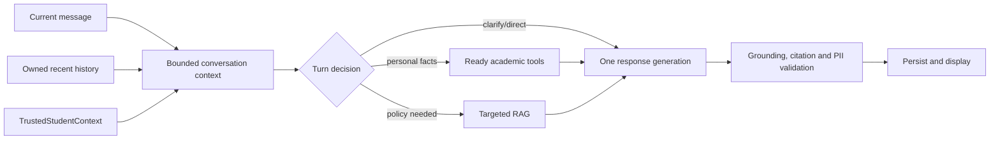

# Conversational Academic Advisor Implementation Plan

> **For agentic workers:** If execution is later approved, use `superpowers:subagent-driven-development` or `superpowers:executing-plans` task by task. This document authorizes no implementation now.

**Goal:** HaUI Advisor understands a student's aim and constraints across turns, selects the smallest justified combination of RAG and academic tools, and gives natural, grounded decision support without inventing academic facts.

**Architecture:** Keep the existing `AdvisorFacade → ToolAdapter → AcademicFacade` and `RagAdvisorService` boundaries. Add a bounded per-turn decision context derived from authenticated student context, recent conversation and current request. Start with deterministic selection and argument validation before one response-generation call; evaluate LLM-selected function calls only if this fails measured acceptance criteria.

**Tech stack:** Java 21, Spring Boot, Maven/JUnit, existing Gemini REST adapter, PostgreSQL conversation store, React planner UI. No new framework, vector store, memory service or dependency is planned.

**Design basis:** [Conversational Quality audit](../../../tv1-ai/docs/audits/2026-11-05-conversational-quality-audit.md), [experiment results](../../../tv1-ai/docs/audits/2026-11-05-conversational-quality-experiments.json), the current codebase and the user brief of 05/11/2026. The audited worktree contains earlier uncommitted changes; implementation must preserve and review those changes separately.

## Tóm tắt quyết định thiết kế

Giữ Academic Engine làm nguồn tính toán, RAG làm nguồn quy chế và LLM làm bộ phận diễn giải, tư vấn. Trước mắt dùng quyết định theo ngữ cảnh ngay trong pipeline hiện có: đọc tối đa 10 thông điệp thuộc đúng sinh viên, xác định mục tiêu và dữ kiện còn thiếu, rồi chỉ gọi RAG hoặc Academic Tool khi câu trả lời thực sự cần. Mọi tham số cá nhân phải có nguồn gốc rõ ràng; nếu thiếu dữ kiện quyết định thì hỏi làm rõ. Cách này giữ một lượt gọi model để tạo câu trả lời. Chỉ thử LLM function calling cho các lượt phức tạp nếu phương án này không đạt bộ đánh giá và phần chất lượng tăng thêm bù được độ trễ, chi phí.

| Giai đoạn | Sản phẩm nghiệm thu | Phụ thuộc |
| --- | --- | --- |
| 0. Baseline | Bộ hội thoại nhiều lượt, nhãn tool/RAG, đo chất lượng, latency và cost hiện tại. | Không |
| 1. PII/định dạng | Che đúng đoạn PII, giữ nguyên xuống dòng và Markdown. | Case tái hiện từ 0 |
| 2. Hiểu hội thoại | Mục tiêu, ràng buộc, tham số và nguồn gốc qua nhiều lượt; hỏi làm rõ đúng lúc. | Nhãn từ 0; triển khai độc lập với 1 |
| 3. Điều phối | Chọn tối thiểu Academic Tools và RAG; kiểm tra readiness, quyền, tham số và dependency. | 2 |
| 4. Câu trả lời cố vấn | Diễn giải kết quả, so sánh phương án, phân biệt dữ kiện/quy chế/lời khuyên, citation đúng claim. | 1–3 |
| 5. Thử nghiệm có điều kiện | A/B LLM đề xuất structured tool calls với backend xác thực; quyết định dùng hay bỏ. | Kết quả 3–4; có thể bỏ qua |
| 6. Tích hợp | Kiểm thử xuyên backend/UI, so baseline và rollout có thể quay lại. | 1–4; 5 tùy chọn |

Các ngưỡng số trong tài liệu là **tiêu chí đề xuất để nghiệm thu**, chưa phải kết quả đo hoặc kết luận rằng thiết kế mới sẽ đạt chúng. Chi tiết kỹ thuật và phép kiểm chứng nằm trong từng phase bên dưới.

## Global constraints

- Do not move GPA/CPA, eligibility, graduation or planning calculations into the LLM. `AcademicFacade` remains authoritative.
- Student identity and data revision come only from `TrustedStudentContext`; model text, history and tool arguments cannot replace them.
- Preserve conversation ownership checks, `readyCapabilities()`, tool timeout and total chat timeout. Production never treats a mock capability as real.
- A missing or conflicting personal fact is **unknown**, not a default. No plan, simulation or personal recommendation may present an assumed CPA, grade, semester, credits or plan ID as verified.
- RAG provides policy evidence; academic tools provide student facts and computations; the LLM interprets and communicates them. An attached citation must correspond to a policy claim actually used in the answer.
- The default path has at most one generation API call per answered turn. Additional calls require a measured quality benefit and an explicit release gate.

## Review focus and expected behavior

| Input/failure mode | Expected behavior | Owning phase |
| --- | --- | --- |
| “Mình sợ trễ tốt nghiệp” with no transcript | Acknowledge concern, state what is unknown, ask one useful question; no fabricated audit result or plan. | 2, 3, 4 |
| “Nhưng nếu mình không đủ thời gian?” after comparing two options | Carry forward the options and time constraint; do not convert it into an unrelated policy lookup. | 2, 3 |
| “Đăng ký bao nhiêu tín?” with no target or time capacity | Use verified risk/status if available; explain a conditional range only when grounded; ask for the missing constraint before recommending a personal number. | 2, 3 |
| `VALIDATE_STUDY_PLAN` unavailable or one tool times out | No claim that validation succeeded; keep useful verified results, show a precise limitation. | 3, 4 |
| Student B references Student A's conversation or plan ID | Deny access before retrieval/tool execution; do not surface A's data in prompt, logs or response. | 2, 3, 5 |

## Confirmed capability map and current integration

The [nine `AcademicCapability` values](../../../tv5-platform/contracts/src/main/java/vn/haui/advisor/contracts/dto/AcademicCapability.java) match methods of [AcademicFacade](../../../tv5-platform/contracts/src/main/java/vn/haui/advisor/contracts/ports/AcademicFacade.java) and [ToolAdapter](../../../tv1-ai/src/main/java/vn/haui/advisor/ai/tools/ToolAdapter.java). Production uses [RecordBackedAcademicFacade](../../../tv5-platform/app/src/main/java/vn/haui/advisor/platform/academic/RecordBackedAcademicFacade.java) over DB records, and `DefaultToolAdapter` injects trusted identity/revision and validates inputs ([DefaultToolAdapter.java:69–231](../../../tv1-ai/src/main/java/vn/haui/advisor/ai/tools/DefaultToolAdapter.java)). “Declared” does not mean safe to invoke with incomplete arguments.

| Capability | Input other than trusted student ID/revision; meaningful output | Current route in chat | Runtime readiness / proposed gate |
| --- | --- | --- | --- |
| `GET_ACADEMIC_STATUS` | No extra input; GPA, CPA, accumulated/required credits, risk, warnings. | `DEBT_COURSES`, `STUDY_PLAN`, `RETAKE_IMPROVEMENT`, some `GENERAL`. | Ready by default. Use for a personal status question or as a prerequisite to a decision that needs current CPA/risk; avoid if another requested tool already returns the needed facts. |
| `CHECK_COURSE_ELIGIBILITY` | Course code and optional target semester; eligibility, missing prerequisites, warnings. | `DEBT_COURSES` only when a code is extracted, with a hardcoded semester fallback. | Ready by default. Require a confirmed course code; ask for the term only if the answer depends on it. |
| `GENERATE_STUDY_PLAN` | Optional target graduation semester, CPA target, credit cap, summer choice, retake codes; proposal, semesters, projected CPA, warnings. The engine permits nulls, but that does not make invented goals safe. | `STUDY_PLAN`, `ACCELERATED_STUDY`, `GOAL_CHANGE`, `GENERAL`, often with hardcoded goals. | Ready by default. Use only after the student requests a concrete plan and the decision-critical goal/constraint is explicit or verified. Never label an engine fallback as the student's chosen target. |
| `VALIDATE_STUDY_PLAN` | Plan ID, semesters, version; valid/violations/warnings, validation mode. | `ACCELERATED_STUDY` passes a mostly empty request. | **Not ready by default** in `DefaultAcademicFacade.readyCapabilities()`; enabled only by its explicit flag/property. Require a real proposal/draft payload and `READY`; do not imply validation from plan generation alone. |
| `SIMULATE_GRADES` | List of course code, credits, expected grade/points; current CPA, expected GPA, projected CPA, delta. | `WHAT_IF`, with a generic 18-credit B+ fallback when grades are missing. | Ready by default. Require a clearly hypothetical scenario and enough course/credit/grade inputs; label the result as simulation. |
| `RANK_RETAKE_COURSES` | Optional max suggestions; ranked course recommendations and CPA deltas. | `RETAKE_IMPROVEMENT`, often with 3 suggestions. | Ready by default. Use when the student asks which **actual** courses to improve or a comparison needs candidate courses; do not treat ranking as a full schedule or time estimate. |
| `CALCULATE_TARGET_GRADES` | Required CPA target, optional graduation semester; remaining credits and required average GPA/course requirements. | `GOAL_CHANGE`, with a hardcoded CPA target if missing. | Ready by default. Require an explicit CPA target; clarify ambiguous deadlines. |
| `RUN_GRADUATION_AUDIT` | No extra input; eligibility, progress, checklist and pending certificate actions. | `GRADUATION_AUDIT`. | Ready by default. Prefer for “am I on track/what is missing?”; add `GET_ACADEMIC_STATUS` only if CPA/risk is needed and not present. |
| `RECONCILE_STUDY_PLAN` | Owned plan ID, completed semester, plan version; on-track state, missed courses and recommended adjustments. | Any message containing “đồng bộ”/`reconcile`, with hardcoded `PLAN-CURRENT`, `2024_1`, version `1`. | Ready by default as a capability, but the runtime checks ownership against stored plans. Exclude from open-ended automatic calling until the plan ID/version/term come from an owned stored plan or explicit, verified selection. |

Readiness is defined in [DefaultAcademicFacade.java:55–83](../../../tv4-academic/src/main/java/vn/haui/advisor/academic/service/DefaultAcademicFacade.java), exposed by [AcademicToolGate.java:47–90](../../../tv5-platform/app/src/main/java/vn/haui/advisor/platform/academic/AcademicToolGate.java) and checked again by [DefaultAdvisorFacade.java:547–587](../../../tv1-ai/src/main/java/vn/haui/advisor/ai/service/DefaultAdvisorFacade.java). The present chat routes and defaults are in [DefaultAdvisorFacade.java:218–505](../../../tv1-ai/src/main/java/vn/haui/advisor/ai/service/DefaultAdvisorFacade.java). The DTO field inventory is the request/response classes in `tv5-platform/contracts/src/main/java/vn/haui/advisor/contracts/dto/`; implementation should reuse them, not define parallel tool schemas.

## Decision design

### Per-turn context and precedence

Create the smallest internal record needed for this turn: current goal (`understand`, `compare`, `decide`, `plan`, `check-policy`), relevant topic/referent, constraints (time, graduation deadline, credit cap), candidate slots (`courseCode`, `semester`, `targetCpa`, hypothetical grades, owned plan ID/version), and provenance for each (`current user`, `earlier user`, `verified academic result`, `unknown`). Derive it from the current request plus the existing 10-message history window; do not create long-term memory or new DB tables in the first pass. A recent explicit correction supersedes an earlier user claim. Verified academic facts supersede user-reported current CPA, but the response should explain the discrepancy rather than silently rewrite it. An ambiguous pronoun, stale goal or conflict triggers one targeted clarification. If an old constraint falls outside the history window, ask again instead of inventing it.

The current `IntentClassifier` may remain the cheap extractor for explicit terms, but its single `ScenarioCategory` cannot represent “compare two options under a time constraint” or a turn asking both policy and personal status. A proposed internal `TurnDecision` should allow `response mode`, `required capabilities`, `needPolicyEvidence`, `missing critical slots`, and `argument provenance`; it need not change the public `ChatRequest`/`ChatResponse` contract. The existing [history manager](../../../tv1-ai/src/main/java/vn/haui/advisor/ai/conversation/ConversationHistoryManager.java) and [student context](../../../tv5-platform/contracts/src/main/java/vn/haui/advisor/contracts/dto/TrustedStudentContext.java) remain the sources.

### Tool and RAG policy

- **Direct response:** empathy, general study strategy, follow-up about time or priorities; no academic tool or RAG unless a personal number or policy claim is needed.
- **Clarify first:** a missing CPA target, course code, hypothetical grades, owned plan ID or decision-critical time/goal. Ask only for the next fact needed; provide conditional advice if useful while waiting. Do not use `3.0`, `18`, a fixed semester, `GEN_SIM`, or `PLAN-CURRENT` as the student's parameters.
- **Policy lookup:** retrieve on explicit regulation questions or when a recommendation needs a policy boundary (credit limits, retake eligibility, graduation conditions). Do not retrieve simply because the topic is academic. If using history for a follow-up, form the retrieval question from the resolved referent and current ask, not the bare latest sentence.
- **Personal facts and computation:** invoke the minimum ready capability set. Independent calls may run concurrently within the existing budget when this actually saves latency; dependent calls run in order. A `READY` check, slot validation and trusted identity injection precede execution. Never retry a failed tool by substituting an assumed value.
- **Complex comparison:** for “cải thiện hay môn mới”, first understand the student's primary goal and available time; use status/ranking/eligibility only for concrete personal comparison. Do not call `GENERATE_STUDY_PLAN` solely because “học kỳ tới” appears. Cite policy only for policy limits, not for a subjective recommendation.

| User need | Minimal likely execution | Dependency/avoidance |
| --- | --- | --- |
| “CPA thấp, giờ sao?” | Often direct advice + one clarification; `GET_ACADEMIC_STATUS` if authenticated record is available and current risk changes advice. | No automatic plan/ranking/RAG. |
| “Sợ không tốt nghiệp đúng hạn; còn thiếu gì?” | `RUN_GRADUATION_AUDIT`; policy RAG only when explaining a specific rule. | Add status only if audit lacks a needed CPA/risk fact. |
| “Kỳ tới nên đăng ký bao nhiêu tín?” | `GET_ACADEMIC_STATUS` for risk; policy RAG for legal cap; ask time capacity and goal. | Do not call plan generator for a vague number. |
| “Học cải thiện hay môn mới, chỉ rảnh buổi tối?” | Clarify deadline/priority; `GET_ACADEMIC_STATUS` and `RANK_RETAKE_COURSES` if concrete ranking is requested; `CHECK_COURSE_ELIGIBILITY` for a named new course. | Compare trade-offs; no inferred time cost from rank output. |
| “Nếu 2 môn 3 TC đạt B+ thì CPA?” | `SIMULATE_GRADES`. | Require explicit grades/credits; model does no arithmetic. |
| “Đổi mục tiêu CPA thành 3.2; lập lại kế hoạch” | `CALCULATE_TARGET_GRADES` then `GENERATE_STUDY_PLAN` with confirmed term/credit cap; validate only if ready and payload exists. | A goal-change mention alone need not generate a plan. |
| “Đối chiếu kế hoạch đang lưu sau kỳ này” | Resolve owned plan/version/term, then `RECONCILE_STUDY_PLAN`. | No hardcoded ID, period or version. |

### Interpreting tool results and citations

Send the model only the verified fields needed for the selected decision, with `dataRevision`/policy version retained for validation. Avoid exposing `studentId` in the prompt's formatted academic status; `ToolAdapter` still uses it internally ([LiveAdvisorModel.java:348–394](../../../tv1-ai/src/main/java/vn/haui/advisor/ai/model/LiveAdvisorModel.java)). The answer should separate, in natural prose when appropriate: **policy rule** (retrieved source), **your verified record/tool result** (authoritative), **interpretation/trade-off** (reasoned), and **suggested next step** (conditional). This is an internal evidence discipline, not a mandatory four-heading template. If evidence is missing, name the uncertainty and avoid personal conclusions.

Keep the existing `ChatResponse` fields initially. Require inline source IDs for policy claims and populate `sources` only from those IDs after validating them against retrieved chunks. Do not auto-attach all retrieved citations to a plain-text answer as currently done in [LiveAdvisorModel.java:438–443](../../../tv1-ai/src/main/java/vn/haui/advisor/ai/model/LiveAdvisorModel.java). Validate source **identity** mechanically; test semantic support with a labeled claim-level eval, because source-ID membership alone cannot prove a claim. Never present a tool result as a regulatory citation. Avoid hardcoded greetings, repetitive sections and boilerplate conclusions; answer length should depend on the decision's complexity.

### PII and format correction

The confirmed regression is `replaceAll("\\s{2,}", " ")` in [ResponseGroundingValidator.java:148–158](../../../tv1-ai/src/main/java/vn/haui/advisor/ai/grounding/ResponseGroundingValidator.java). Plan a surgical redaction of only matched unsolicited student-code spans. Preserve all other characters, including paragraph breaks and Markdown list indentation. Test both unrequested and explicitly requested IDs, adjacent punctuation, multiple IDs, Unicode whitespace, and no-match output byte equality. Keep the trusted identity out of the model prompt where unnecessary and run PII validation on the final answer, including any future structured response path. Do not relax cross-account or source validation to fix formatting.

## Alternatives and selection gate

| Approach | Benefits | Costs and risk | Decision |
| --- | --- | --- | --- |
| **A. Context-aware deterministic policy** over existing classifier, tools and one LLM response call | Reuses code, auditable arguments, expected one generation call; selective RAG/tools can reduce work. | Rule coverage and coreference may plateau; needs a real labeled eval. | **Implement first**. Do not claim it matches an LLM planner until measured. |
| **B. Hybrid: LLM proposes structured `TurnDecision`/function call only for uncertain turns** | Better handling of ambiguous, mixed, multi-tool requests if proven. | Usually adds a model round trip before the final answer, provider-specific protocol, token cost, latency and untrusted arguments. | Run a gated shadow experiment only if A misses acceptance on complex turns; backend revalidates every proposal. |
| **C. Full agent framework/autonomous tool loop** | Broad exploration and dynamic chaining. | Large surface, variable latency/cost, harder audit and safety; no demonstrated need in this codebase. | Defer. No framework or fine-tuning in this plan. |

Gemini's official [function-calling guide](https://ai.google.dev/gemini-api/docs/generate-content/function-calling) confirms that the model proposes named calls and arguments, **the application executes them**, then supplies results for a final model answer; multiple calls can be proposed. This is technically feasible, but the current `LiveAdvisorModel` sends only text in `contents` and reads only the first text part, so it does **not** currently support function-call parts ([LiveAdvisorModel.java:211–250](../../../tv1-ai/src/main/java/vn/haui/advisor/ai/model/LiveAdvisorModel.java)). [Structured output documentation](https://ai.google.dev/gemini-api/docs/generate-content/structured-output) likewise requires backend value validation even when JSON is schema-conformant. Do not expose arbitrary facade methods or student IDs to the model. If B is tested, define an allowlisted, read-oriented tool subset, cap call count and depth, reject unknown/unsafe arguments, and preserve the same readiness/ownership checks as A.

## Phases and executable tasks

Each phase is independently reviewable and testable. Merge/enable only after its gate; later phases depend on accepted earlier contracts. The first four phases need no extra generation call. File paths below are planned touch points, not edits made by this document.

### Phase 0 — Baseline and evaluation contract

**Dependency:** none. **Deliverable:** frozen baseline, labeled dataset and measurement harness; no product behavior change.

**Files:** Extend `tv1-ai/src/test/resources/eval/` with conversational cases, add a focused eval runner under `tv1-ai/src/test/java/vn/haui/advisor/ai/eval/`; retain `ChatEvalBenchmarkRunnerTest.java` for existing contract coverage. Store redacted measurement output under `tv1-ai/docs/audits/`.

- [ ] Label at least **40 conversations / 120 turns** across direct answer, clarification, policy-only, one tool, multi-tool, no-tool, missing transcript, follow-up, policy-plus-personal, failure and cross-account cases. For each turn annotate needed capability set (including empty), allowed arguments and provenance, RAG yes/no, must-ask fact, policy claim IDs, forbidden fabrications and an advisor-quality rubric. Review labels by two people on a sample; resolve disagreements before scoring.
- [ ] Replay the **current working tree** with pinned commit/diff, model ID, temperature, fixtures and API status. Report actual baseline precision/recall and latency/cost; do not extrapolate the audit's 13 successful direct-model samples to production.
- [ ] Record per-boundary timings (`context`, RAG, each tool, model, validation, total), model call count and token usage when provider returns it, with no raw PII in logs. Include raw vs validated formatting checks.
- [ ] Build a deterministic tool-selection/argument test suite and a separate live, multi-seed advisor-quality suite; skip with an explicit “not measured” result when quota is exhausted, never silently pass.

**Gate:** dataset and scoring rules reviewed; baseline captured or explicitly marked unavailable, with no success claim based on mock-only tests. **Risk:** noisy human labels/model variability; mitigate with paired cases, fixed fixtures and multiple runs.

### Phase 1 — Preserve format while redacting PII

**Dependency:** Phase 0's replay cases. **Deliverable:** byte-preserving no-match validation and unchanged protection for unsolicited IDs.

**Files:** `tv1-ai/src/main/java/vn/haui/advisor/ai/grounding/ResponseGroundingValidator.java`, `tv1-ai/src/test/java/vn/haui/advisor/ai/grounding/ResponseGroundingValidatorTest.java`, `tv1-ai/src/test/java/vn/haui/advisor/ai/model/LiveAdvisorModelPromptTest.java`; UI renderer test only if the backend result still renders incorrectly.

- [ ] Write failing tests for raw Markdown paragraphs/list indentation passing through both `LiveAdvisorModel.generate()` and facade validation unchanged when no PII matches; include the audit's 10-newline replay fixture.
- [ ] Write/retain security cases for unsolicited student codes, explicit ID requests, multiple IDs and punctuation; assert no wrong-account ID leaks in answer or metadata.
- [ ] Replace only the matched ID span and avoid global whitespace collapse; rerun focused security and formatting tests plus existing UI Markdown test.

**Gate:** no-match answer text identical; all known PII cases redacted; list/paragraph rendering preserved; no new provider call. **Risk:** overly narrow regex may leak unusual ID forms, so test against actual ID formats before release.

### Phase 2 — Understand goals, constraints and missing facts

**Dependency:** Phase 0 labels; independent of Phase 1's implementation. **Deliverable:** per-turn context and clarification decision, initially used in shadow comparison against current routing.

**Files:** `tv1-ai/src/main/java/vn/haui/advisor/ai/intent/IntentClassifier.java`, `ParsedUserIntent.java` only where still useful; add one small internal decision/context type under `tv1-ai/src/main/java/vn/haui/advisor/ai/service/` or `intent/`; `DefaultAdvisorFacade.java`, `ConversationHistoryManager.java` only if required by the bounded-window API; tests in corresponding test packages.

- [ ] Add cases where “môn đó”, “phương án nào”, a changed goal and a new time constraint refer to earlier turns; assert correct referent, correction precedence and unknown when context is outside the window.
- [ ] Derive only decision-relevant slots and their provenance from the owned 10-message history and current request. Keep academic metrics separate until verified by a tool; preserve the existing `conversationId`/student ownership boundary.
- [ ] Define a testable `DIRECT / CLARIFY / POLICY / PERSONAL_ANALYSIS / PLAN` decision with a possible tool set, rather than treating the single old category as the complete conversation state. Ask one targeted question if an essential slot is absent or conflicting.
- [ ] Compare shadow decisions with labeled cases; do not enable tool routing until Phase 3.

**Gate:** on the frozen dataset, at least **95%** of required-clarification cases identified, **0** fabricated slot values, **0** cross-account context access; any unresolved referent is marked unknown. **Risk:** short history may lose old goals; ask again instead of adding persistent memory prematurely.

### Phase 3 — Context-aware RAG and tool orchestration

**Dependency:** Phase 2 decision/provenance contract and Phase 0 labels. **Deliverable:** minimum justified, ready tool set per turn; one generation call remains.

**Files:** `DefaultAdvisorFacade.java`, a small selection policy adjacent to it if needed, `DefaultToolAdapter.java`/`ToolParameterValidator.java` only for missing validation, `RagAdvisorService.java` only for contextual query input, `AdvisorConfig.java` wiring; focused orchestration tests and platform integration tests.

- [ ] Test **must-call, must-not-call, multi-tool, missing-argument, unavailable capability, timeout, follow-up and cross-account** cases first. Assert exact capability set/order and exact arguments, not merely that the answer sounds plausible.
- [ ] Remove hardcoded personal targets from chat dispatch (`2025_2`, `3.0`, `18`, generic B+ simulation, `PLAN-CURRENT`, etc.). If an engine API permits null, distinguish “engine default/illustration” from student-confirmed parameters and do not create a personalized plan without confirmed essentials.
- [ ] Resolve capability readiness per request; build small dependency plans (e.g. status before ranking if needed; target-grade calculation before requested plan). Do not call `VALIDATE_STUDY_PLAN` without `READY` and a real plan payload, or `RECONCILE_STUDY_PLAN` without an owned plan/version/term.
- [ ] Gate RAG by policy-evidence need and rewrite follow-up retrieval queries from the resolved topic. Retain evidence thresholds/citation grounder. Provide a safe uncertainty path if retrieval yields no evidence.
- [ ] Preserve current tool budget **≤3**, per-tool timeout and platform **45-second** total deadline. Execute independent calls concurrently only after verifying it does not create inconsistent DB revisions or exceed limits.

**Gate:** labeled tool-selection precision **≥95%**, recall **≥90%**, argument correctness **≥98%**, **0** calls with unverified student identity or invented decision-critical parameters, **0** unsupported “tool succeeded” claims. Compare RAG recall on policy cases against baseline; no drop greater than **2 percentage points**. **Risk:** an overly strict gate may omit necessary policy/tools; inspect false negatives before rollout.

### Phase 4 — Advisor-style response and claim-grounded citations

**Dependency:** Phases 1–3. **Deliverable:** responses that interpret verified results and support decisions without template repetition.

**Files:** `LiveAdvisorModel.java` prompt/formatting and parsing, `AdvisorModelInput.java` only if the decision/evidence contract needs an explicit field, `ResponseGroundingValidator.java`, `DefaultAdvisorFacade.java`, targeted model/grounding tests, and `tv3-planner-ui/src/pages/ChatAdvisorPage.js` only if citation presentation needs adjustment.

- [ ] Add paired cases with identical tool/RAG inputs that require short direct advice, one clarification, two-option trade-off, detailed plan interpretation and policy explanation. Score factual attribution and naturalness separately.
- [ ] Give the model compact verified facts and selected evidence, not a raw dump of every tool/result/chunk. Keep numeric values verbatim from Academic Engine; explicitly label simulated results and unknowns. Avoid mandatory greeting/section templates.
- [ ] Retain citations only for actually referenced, validated policy source IDs. Test policy versus tool fact versus inference versus recommendation; reject unsupported IDs and ungrounded personal numbers. Do not auto-attach all retrieved sources.
- [ ] Replay raw → parsed → validated → UI for Markdown preservation and citation precision. Keep failure/clarification responses useful and honest.

**Gate:** blinded advisor rubric (understanding, timely clarification, option analysis, naturalness) median **≥4/5**, at least **80%** turns pass all four dimensions, and **0** critical errors for invented student facts, policy claims or corrupted authoritative numbers. Citation precision **≥95%** at claim level, policy-case citation recall **≥90%**. These are proposed release thresholds; Phase 0 must report whether baseline/sample size supports them. **Risk:** making prose freer can hide unsupported claims; retain claim checks and human review.

### Phase 5 — Conditional LLM tool-selection experiment

**Dependency:** Phase 3 baseline and Phase 4 quality results. **Deliverable:** a go/no-go decision, not an automatic framework migration.

**Files if pursued:** a separate proposal adapter beside `LiveAdvisorModel.java`, allowlisted tool schemas derived from existing DTOs, validator tests, `AdvisorConfig.java` feature gate. No public API or persistence change by default.

- [ ] Trigger only if the deterministic path misses the acceptance threshold on ambiguous/mixed turns after error analysis. Compare A/B on the same pinned cases, model and fixtures.
- [ ] Have the model propose a structured capability and arguments; the backend resolves trusted student ID, verifies slot provenance, ownership, readiness, schema, policy limits and call budget before executing. Never pass raw `studentId` as model-controlled argument.
- [ ] Cap at one proposal round and one final response round, no recursive autonomous loop. On invalid proposal, clarify or use the deterministic path; do not execute a guessed alternative.
- [ ] Report paired tool precision/recall, argument correctness, advice score, provider calls, input/output tokens and p50/p95 latency. Test malformed JSON/function parts, duplicated calls, contradictory history and tool failure.

**Go/no-go:** adopt only if complex-turn advisor pass rate improves by **≥10 percentage points** without lowering safety/grounding gates, while p95 latency stays under both the platform 45-second deadline and a **20%** increase over Phase 3, and mean provider cost per turn rises **≤15%**. Otherwise retain the deterministic path. These are decision thresholds, not claims of expected performance.

### Phase 6 — Integration and controlled release

**Dependency:** Phases 1–4 accepted; Phase 5 optional. **Deliverable:** one end-to-end, observable advisor flow behind a reversible rollout gate.

**Files:** platform integration tests around `AdvisorChatService.java`/`AdvisorConfig.java`, UI chat tests, docs for runbook/eval. Reuse existing configuration conventions; add one rollout flag only if necessary for safe comparison.

- [ ] Run cross-account, transcript-missing, stale revision, owned-plan, policy-version, tool-unavailable and provider-failure scenarios through backend persistence and UI. Verify the same conversation ID retains context over multiple turns.
- [ ] Compare paired baseline/new traces for tool calls, retrievals, latency, token usage and user-visible citations. Keep raw student content out of telemetry. Verify frontend does not fall back to mock content during a live error.
- [ ] Enable gradually with rollback to the prior route. Review false negatives, advice failures and PII/grounding alerts before wider release.

**Gate:** all safety and quality gates above pass, no regression in existing Maven/frontend suites, **one generation call per normal turn**, p95 total latency **≤45 seconds and ≤baseline +10%** for the default path, mean provider cost **≤baseline +5%**, and no higher mean academic-tool-call count. If a baseline is unavailable, do not claim these gates met; measure first. **Risk:** load and provider variance may obscure small gains; use paired cohorts and report confidence intervals.

## Latency and cost guardrails

The current successful live path uses one generation call at temperature `0.2`; it also performs RAG for every turn and may call several academic tools ([DefaultAdvisorFacade.java:142–164](../../../tv1-ai/src/main/java/vn/haui/advisor/ai/service/DefaultAdvisorFacade.java), [LiveAdvisorModel.java:211–223](../../../tv1-ai/src/main/java/vn/haui/advisor/ai/model/LiveAdvisorModel.java)). The recommended path keeps that one LLM call, derives decision context locally from the bounded history, skips RAG/tools when unneeded, and sends only relevant evidence. These changes may lower average latency and token use, but that is a hypothesis until Phase 0/6 measurements. Avoid an extra “understanding” model call, per-turn LLM summaries, recursive tool loops and provider changes in the default release. Cache only immutable policy chunks by version if profiling shows retrieval is expensive; never cache student-specific results across users or data revisions.

## Explicit non-goals for this plan

No fine-tuning, knowledge graph, agent framework, long-term memory service, new Academic Engine calculation, new UI feature or blanket “speak more naturally” prompt. Preserve the existing API response contract unless evidence shows it cannot carry the required attribution. Future changes should be selected by the phase gates, not by presumed novelty.
