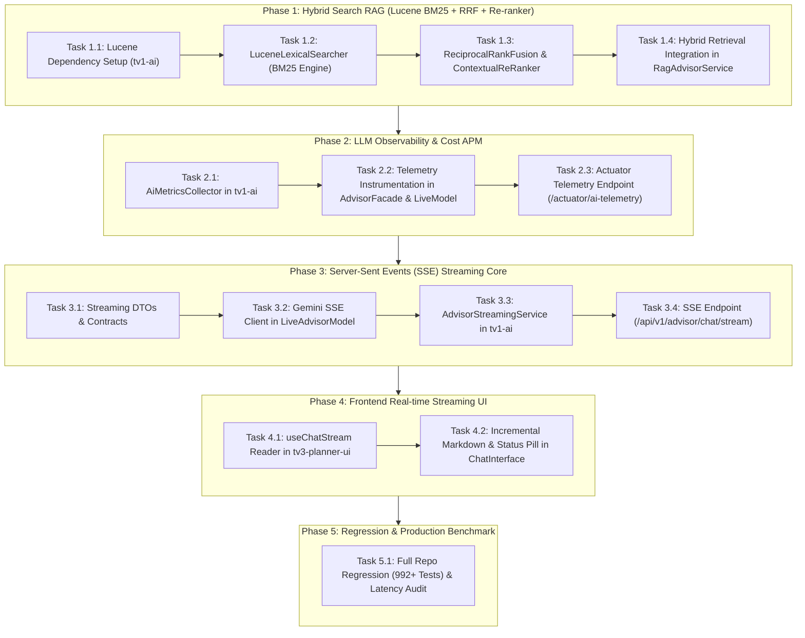

# Implementation Plan: Production AI Chatbot Hardening (Grade 9.0+)
## Streaming (SSE), Hybrid Search (BM25 + Vector) & LLM Observability

- **Date**: 2026-11-09
- **Topic**: Implementation of Production-Grade AI Hardening
- **Spec**: [`docs/superpowers/specs/2026-11-09-production-ai-hardening-design.md`](../specs/2026-11-09-production-ai-hardening-design.md)
- **Workspaces Affected**: `tv1-ai`, `tv5-platform`, `tv3-planner-ui`
- **Branch**: `feature/production-ai-hardening-9.0`
- **Target Standard**: Grade 9.0+ Production Enterprise AI

---

## Task Decomposition Overview



---

## Detailed Bite-Sized Tasks

### Phase 1: Hybrid Search RAG (Lucene BM25 + Vector + Re-ranking)

#### Task 1.1: Add Embedded Apache Lucene Dependency to `tv1-ai/pom.xml`
- **Files touched:** `tv1-ai/pom.xml`, `pom.xml` (parent dependency management if needed).
- **Goal:** Add `org.apache.lucene:lucene-core:9.10.0` and `org.apache.lucene:lucene-analysis-common:9.10.0` with scope compile.
- **Verification:**
  ```bash
  .\mvnw.cmd compile -pl tv1-ai
  ```
- **Commit:** `build(tv1): add embedded lucene 9.10 dependencies for lexical bm25 search`

#### Task 1.2: Implement `LuceneLexicalSearcher` with Vietnamese Diacritic Folding
- **Files touched:**
  - Create `tv1-ai/src/main/java/vn/haui/advisor/ai/rag/search/LuceneLexicalSearcher.java`
  - Create test `tv1-ai/src/test/java/vn/haui/advisor/ai/rag/search/LuceneLexicalSearcherTest.java`
- **Implementation Details:**
  - Uses in-memory Lucene `ByteBuffersDirectory`.
  - Indexes `RagChunk`: `chunkId`, `sourceId`, `section`, `content`, `keywords`.
  - Analysis: `StandardTokenizer`, `LowerCaseFilter`, `ASCIIFoldingFilter` for diacritic-insensitive term matching (*"Điều 14"* &harr; *"dieu 14"*).
  - Search: BM25 similarity scoring, returns list of `LexicalHit(chunkId, score, section)`.
- **TDD:**
  1. Write unit test asserting exact keyword matching for *"Khoản 2 Điều 14"*, *"F23-006"*, *"học cải thiện"*.
  2. Implement `LuceneLexicalSearcher`.
  3. Run test: `.\mvnw.cmd test -pl tv1-ai -Dtest=LuceneLexicalSearcherTest`.
- **Commit:** `feat(ai): implement lucene lexical bm25 searcher with diacritic folding`

#### Task 1.3: Implement Reciprocal Rank Fusion (`ReciprocalRankFusion`) & Re-ranking Filter (`ContextualReRanker`)
- **Files touched:**
  - Create `tv1-ai/src/main/java/vn/haui/advisor/ai/rag/search/ReciprocalRankFusion.java`
  - Create `tv1-ai/src/main/java/vn/haui/advisor/ai/rag/search/ContextualReRanker.java`
  - Create test `tv1-ai/src/test/java/vn/haui/advisor/ai/rag/search/ReciprocalRankFusionTest.java`
- **Implementation Details:**
  - Formula: $RRF(d) = \sum \frac{1}{60 + r_m(d)}$.
  - `ContextualReRanker`: Evaluates Top-10 fused candidates, scores semantic overlap against query intent, and filters down to Top-3 chunks ($\sigma \ge 0.55$).
- **TDD:**
  1. Write unit test verifying rank fusion with mock dense & lexical ranked lists.
  2. Implement RRF and ReRanker.
  3. Run test: `.\mvnw.cmd test -pl tv1-ai -Dtest=ReciprocalRankFusionTest`.
- **Commit:** `feat(ai): implement rrf rank fusion and contextual reranking filter`

#### Task 1.4: Wire Hybrid Search into `RagAdvisorService`
- **Files touched:**
  - Modify `tv1-ai/src/main/java/vn/haui/advisor/ai/rag/service/RagAdvisorService.java`
  - Create test `tv1-ai/src/test/java/vn/haui/advisor/ai/rag/search/HybridSearchIntegrationTest.java`
- **Implementation Details:**
  - In `init()` / catalog ingestion: Index all chunks into both `VectorStore` and `LuceneLexicalSearcher`.
  - In `retrieveAndGround(query, topK, minScore)`: Query both dense vector store and Lucene BM25 concurrently, fuse via RRF, apply re-ranking, and return grounded context.
- **TDD:**
  1. Write integration test retrieving real HaUI bylaws chunks with exact entities and semantic terms.
  2. Run test: `.\mvnw.cmd test -pl tv1-ai -Dtest=HybridSearchIntegrationTest`.
- **Commit:** `feat(ai): integrate hybrid search rrf pipeline into rag advisor service`

---

### Phase 2: LLM Observability & Cost APM

#### Task 2.1: Implement `AiMetricsCollector` in `tv1-ai`
- **Files touched:**
  - Create `tv1-ai/src/main/java/vn/haui/advisor/ai/telemetry/AiMetricsCollector.java`
  - Create `tv1-ai/src/main/java/vn/haui/advisor/ai/telemetry/AiTelemetrySnapshot.java`
  - Create test `tv1-ai/src/test/java/vn/haui/advisor/ai/telemetry/AiMetricsCollectorTest.java`
- **Implementation Details:**
  - Thread-safe accumulators: `LongAdder` for prompt tokens, generation tokens, total chats, stream chats, tool executions, guardrail overrides.
  - Step latency records: RAG time, Tool time, Turn 1 time, Turn 2 time.
  - Real-time USD cost estimation formula based on Gemini pricing.
- **TDD:**
  1. Write unit test asserting metrics tracking, token calculation, and USD cost formula.
  2. Run test: `.\mvnw.cmd test -pl tv1-ai -Dtest=AiMetricsCollectorTest`.
- **Commit:** `feat(ai): implement thread-safe ai metrics collector and cost telemetry`

#### Task 2.2: Instrument `DefaultAdvisorFacade` and `LiveAdvisorModel`
- **Files touched:**
  - Modify `tv1-ai/src/main/java/vn/haui/advisor/ai/service/DefaultAdvisorFacade.java`
  - Modify `tv1-ai/src/main/java/vn/haui/advisor/ai/model/LiveAdvisorModel.java`
- **Implementation Details:**
  - Record execution time of each pipeline phase into `AiMetricsCollector`.
  - Extract `usageMetadata` (promptTokenCount, candidatesTokenCount) from Gemini JSON response; fall back to character/word ratio approximation if metadata is omitted.
- **Verification:**
  ```bash
  .\mvnw.cmd test -pl tv1-ai -Dtest=DefaultAdvisorFacadeTest
  ```
- **Commit:** `feat(ai): instrument advisor facade and live model with step latency and token telemetry`

#### Task 2.3: Expose Actuator Telemetry Endpoint (`/actuator/ai-telemetry`) in `tv5-platform`
- **Files touched:**
  - Create `tv5-platform/app/src/main/java/vn/haui/advisor/platform/web/AiTelemetryEndpoint.java`
  - Create test `tv5-platform/app/src/test/java/vn/haui/advisor/platform/web/AiTelemetryEndpointTest.java`
- **Implementation Details:**
  - Exposes `@Endpoint(id = "ai-telemetry")` or `@RestController` under `/actuator/ai-telemetry`.
  - Returns `AiTelemetrySnapshot` JSON payload.
- **TDD:**
  1. Write integration test invoking endpoint and verifying JSON structure.
  2. Run test: `.\mvnw.cmd test -pl tv5-platform/app -Dtest=AiTelemetryEndpointTest`.
- **Commit:** `feat(platform): expose actuator ai telemetry endpoint for production monitoring`

---

### Phase 3: Server-Sent Events (SSE) Streaming Core

#### Task 3.1: Define Streaming Contract DTOs in `tv5-platform/contracts`
- **Files touched:**
  - Create `tv5-platform/contracts/src/main/java/vn/haui/advisor/contracts/dto/ChatStreamEvent.java`
  - Update `tv5-platform/contracts/js/` if needed.
- **Implementation Details:**
  - Types: `STATUS`, `TOOL_CALL`, `TOOL_RESULT`, `CITATION`, `CHUNK`, `DONE`, `ERROR`.
  - Payload fields: `phase`, `message`, `toolName`, `text`, `proposal`, `sources`, `metrics`, `code`, `retryable`.
- **Verification:**
  ```bash
  npm run check:contracts
  .\mvnw.cmd compile -pl tv5-platform/contracts
  ```
- **Commit:** `feat(contracts): define chat stream event dtos for sse protocol`

#### Task 3.2: Implement Gemini Streaming API Client in `LiveAdvisorModel`
- **Files touched:**
  - Modify `tv1-ai/src/main/java/vn/haui/advisor/ai/model/LiveAdvisorModel.java`
  - Create test `tv1-ai/src/test/java/vn/haui/advisor/ai/model/LiveAdvisorModelStreamingTest.java`
- **Implementation Details:**
  - Method: `streamTurn(payload, apiKey, Consumer<String> chunkConsumer)`.
  - Connects to `:streamGenerateContent?alt=sse`, parses line-delimited `data: {"candidates":[...]}` chunks, and invokes callback.
- **TDD:**
  1. Write unit test with simulated SSE stream chunks.
  2. Run test: `.\mvnw.cmd test -pl tv1-ai -Dtest=LiveAdvisorModelStreamingTest`.
- **Commit:** `feat(ai): implement gemini line-delimited sse streaming client`

#### Task 3.3: Implement `AdvisorStreamingService` in `tv1-ai`
- **Files touched:**
  - Create `tv1-ai/src/main/java/vn/haui/advisor/ai/service/AdvisorStreamingService.java`
  - Create test `tv1-ai/src/test/java/vn/haui/advisor/ai/service/AdvisorStreamingServiceTest.java`
- **Implementation Details:**
  - Coordinates stream lifecycle:
    1. Emits `status` event (100ms).
    2. Inspects tools via `inspectTurn`. Emits `tool_call` and `tool_result` (with `ChatPlanProposal` if generated).
    3. Retrieves RAG evidence, emits `citation` event.
    4. Streams text chunks via `completeTurnWithToolResultsStream`.
    5. Emits `done` event with metrics, persists conversation asynchronously.
- **TDD:**
  1. Write unit test verifying the exact sequence of emitted events.
  2. Run test: `.\mvnw.cmd test -pl tv1-ai -Dtest=AdvisorStreamingServiceTest`.
- **Commit:** `feat(ai): implement multi-phase advisor streaming service`

#### Task 3.4: Implement SSE Endpoint (`POST /api/v1/advisor/chat/stream`) in `tv5-platform`
- **Files touched:**
  - Modify `tv5-platform/app/src/main/java/vn/haui/advisor/platform/advisor/AdvisorChatController.java`
  - Create test `tv5-platform/app/src/test/java/vn/haui/advisor/platform/advisor/AdvisorChatStreamApiTest.java`
- **Implementation Details:**
  - Method returning `SseEmitter`.
  - Employs async task executor to process stream without blocking Tomcat servlet thread.
- **TDD:**
  1. Write Spring Boot MVC test verifying `text/event-stream` headers and received events.
  2. Run test: `.\mvnw.cmd test -pl tv5-platform/app -Dtest=AdvisorChatStreamApiTest`.
- **Commit:** `feat(platform): implement sse streaming endpoint in advisor chat controller`

---

### Phase 4: Frontend Real-time Streaming UI (`tv3-planner-ui`)

#### Task 4.1: Implement `useChatStream` Hook in `tv3-planner-ui`
- **Files touched:**
  - Create `tv3-planner-ui/src/hooks/useChatStream.js`
  - Create test `tv3-planner-ui/test/chat-stream.test.mjs`
- **Implementation Details:**
  - Uses `fetch` with `ReadableStream` reader (sending CSRF `X-XSRF-TOKEN` and credentials cookies).
  - Handles events: `status`, `tool_call`, `tool_result`, `citation`, `chunk`, `done`, `error`.
  - Supports abort controller for user-initiated cancellation.
- **TDD:**
  1. Write unit test for stream parser with mocked chunks.
  2. Run test: `node --test tv3-planner-ui/test/chat-stream.test.mjs`.
- **Commit:** `feat(planner-ui): implement useChatStream hook for event-stream parsing`

#### Task 4.2: Integrate Streaming UI in `ChatInterface.jsx`
- **Files touched:**
  - Modify `tv3-planner-ui/src/components/ChatInterface.jsx`
- **Implementation Details:**
  - Displays dynamic status pill (*"Đang kiểm tra tiến độ học vụ..."*).
  - Renders token-by-token animated Markdown content.
  - Displays Proposal Card and Citations block as soon as events arrive.
- **Verification:**
  ```bash
  npm run test
  npm run build
  ```
- **Commit:** `feat(planner-ui): integrate real-time token streaming and status pill in chat interface`

---

### Phase 5: Regression & Production Benchmark

#### Task 5.1: Full Repo Regression & Latency Verification
- **Files touched:**
  - Create `tv1-ai/docs/production-ai-hardening-verification-report.md`
- **Verification Commands:**
  ```bash
  npm run check:all
  .\mvnw.cmd test
  ```
- **Benchmark Checks:**
  - Verify TTFT $< 800\text{ms}$.
  - Verify exact retrieval of `"Điều 14 Khoản 2"` via Hybrid Search.
  - Verify Actuator `/actuator/ai-telemetry` returns non-zero token metrics.
- **Commit:** `docs(ai): record production ai hardening verification and latency benchmark report`

---

## Plan Self-Review & Integrity Check
- **992 Existing Tests Compatibility:** Maintained. `POST /api/v1/advisor/chat` and `MockAdvisorModel` remain 100% untouched.
- **Ownership Boundaries:** All paths strictly map to role owners (`tv1-ai`, `tv5-platform`, `tv3-planner-ui`).
- **Dependencies:** Lucene is self-contained in `tv1-ai` with zero external servers.
- **YAGNI / KISS:** Pure embedded JVM architecture without sprawling Redis or Elasticsearch clusters.

