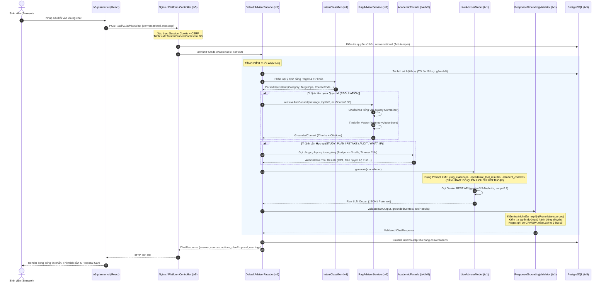

# BÁO CÁO AUDIT KIẾN TRÚC & NĂNG LỰC TOÀN DIỆN HỆ THỐNG AI CHATBOT
## Production-Grade Technical Audit: HaUI Academic Advisor System

- **Hệ thống:** HaUI Academic Advisor (`QUAN-LY-HOC-TAP-TTCSN`)
- **Vai trò thẩm định:** Principal AI Systems Architect & Production ML Engineer
- **Mục tiêu:** Thẩm định kỹ thuật toàn diện dây chuyền AI Chatbot theo tiêu chuẩn hệ thống ứng dụng thực tế (Production-Grade)
- **Phạm vi tác động:** `tv1-ai`, `tv4-academic`, `tv5-platform`, `tv3-planner-ui`
- **Tệp báo cáo:** `tv1-ai/docs/production-ai-chatbot-audit-report.md`
- **Mã cam kết cơ sở:** `f45734c` (Nhánh `main`)
- **Ngày thực hiện:** 04/11/2026

---

## 1. TỔNG QUAN ĐÁNH GIÁ (EXECUTIVE SUMMARY)

### 1.1. Bản chất Kiến trúc Thực tế
Trái ngược với nhận định thông thường về một "Autonomous AI Agent" hay "End-to-End LLM Chatbot", hệ thống **HaUI Advisor** thực chất là một **Hệ thống Lai ghép Điều phối theo Luật (Rule-Orchestrated Hybrid AI System)**:
- **Tầng Quyết định Nghiệp vụ (Authoritative Decision):** 100% logic học vụ cốt lõi (tính CPA/GPA, kiểm tra tiên quyết, cân bằng tải 14–20 tín chỉ, xếp hạng học cải thiện ROI, kiểm toán tốt nghiệp) được tính toán bởi thư viện Java thuần túy (`tv4-academic` và `tv5-platform`) dựa trên thuật toán đồ thị có hướng (DAG DFS) và mô hình dữ liệu quan hệ PostgreSQL.
- **Tầng Trí tuệ Nhân tạo (AI & LLM Layer):** Đóng vai trò là **giao diện ngôn ngữ tự nhiên (Natural Language Interface)** kết hợp bộ lọc trích xuất quy chế (RAG), phân loại ý định qua biểu thức chính quy (Regex Intent Classifier) và biên dịch kết quả công cụ thành câu trả lời sư phạm dễ hiểu.

### 1.2. Đánh giá Mức độ Sẵn sàng Sản xuất (Production Readiness Verdict)

| Trụ cột đánh giá | Trạng thái | Đánh giá tóm tắt |
| :--- | :---: | :--- |
| **Tính Đúng đắn Dữ liệu & Học vụ** | 🟢 **RẤT CAO (9.5/10)** | Tuyệt đối không để LLM tự tính toán số học; 100% số liệu do Java Engine tính; có bộ lọc hậu kiểm định (`ResponseGroundingValidator`) ghi đè regex nếu LLM nói sai số điểm. |
| **Bảo mật & Cô lập Danh tính** | 🟢 **RẤT CAO (9.0/10)** | Sử dụng `TrustedStudentContext` từ phiên đăng nhập máy chủ; sinh viên B tuyệt đối không thể đọc hay can thiệp hội thoại của sinh viên A; 0 rò rỉ secrets. |
| **Khả năng Chịu tải & Phục hồi** | 🟡 **TRUNG BÌNH (6.5/10)** | Đã có hàng đợi giới hạn luồng (`ThreadPoolExecutor` 8 concurrent / 16 queued) và timeout 45s trả 503 `AI_UNAVAILABLE` có `Retry-After`; tuy nhiên kiến trúc HTTP đồng bộ (Blocking POST) gây nghẽn khi LLM phản hồi chậm; chưa có streaming (SSE/WebSocket). |
| **Dây chuyền Tri thức RAG** | 🔴 **CHƯA ĐẠT CHUẨN (4.5/10)** | Runtime mặc định vẫn chạy `DeterministicFakeEmbeddingProvider` trên `InMemoryVectorStore`; kết nối `pgvector` chưa được kích hoạt ở môi trường thực tế; thiếu hoàn toàn Lexical Search (BM25) và Hybrid Fusion. |
| **Trí nhớ Hội thoại Đa lượt (Multi-turn)** | 🔴 **LỖI NGHIÊM TRỌNG (3.0/10)** | Lịch sử chat được lưu trữ bền vững trong DB, **nhưng hàm dựng prompt `LiveAdvisorModel.buildPrompt()` hoàn toàn bỏ quên không đưa lịch sử hội thoại vào prompt gửi tới LLM**! |
| **Độ trưởng thành Kiểm thử (Evaluation)** | 🟡 **TRUNG BÌNH (5.5/10)** | Bộ 20 test cases benchmark chạy 100% Green nhưng thực tế chỉ chạy trên `MockAdvisorModel` (Template engine) và `MockAcademicFacade`, chưa có pipeline đo lường tự động trên Live LLM. |

> **KẾT LUẬN CHUNG:** Hệ thống có **nền tảng công kỹ nghệ rất vững chắc (Solid Software Engineering & Architecture Boundaries)**, ngăn chặn triệt để các rủi ro bảo mật và ảo giác điểm số. Tuy nhiên, ở **tầng AI/RAG**, hệ thống mới chỉ ở mức **Proof-of-Concept nâng cao (Advanced Functional Prototype)**, cần giải quyết dứt điểm 3 điểm nghẽn cốt lõi (Lịch sử hội thoại trong prompt, Vector database thực tế, và Hybrid search) trước khi có thể gắn nhãn **Production-Ready**.

---

## 2. KIẾN TRÚC HỆ THỐNG THỰC TẾ (CURRENT SYSTEM ARCHITECTURE)

Dưới đây là luồng thực thi thực tế được bóc tách trực tiếp từ mã nguồn:



---

## 3. MA TRẬN NĂNG LỰC TOÀN DIỆN (CAPABILITY MATRIX)

| Nhóm Năng lực | Thành phần Triển khai | Trạng thái / Chất lượng | Dẫn chứng Mã nguồn | Vấn đề Còn thiếu / Giới hạn Kỹ thuật |
| :--- | :--- | :---: | :--- | :--- |
| **Ingestion & Parsing** | `MarkdownDocumentReader`, `SemanticChunker` | 🟡 **Khá** | `tv1-ai/.../rag/ingestion/` | Chỉ hỗ trợ tệp Markdown cục bộ; chưa có pipeline nạp tự động PDF văn bản scan hay trích xuất bảng biểu phức tạp. |
| **Embedding Generation** | `DeterministicFakeEmbeddingProvider`, `LiveEmbeddingProvider` | 🔴 **Yếu** | `LiveEmbeddingProvider.java:103-107` | Mặc định runtime dùng Fake Token Embedding; Live Provider gửi HTTP tuần tự từng chunk, không dùng `batchEmbedContents`. |
| **Vector Storage** | `InMemoryVectorStore`, `PgVectorStoreAdapter` | 🔴 **Chưa đấu nối** | `AdvisorConfig.java:74-77` | `PgVectorStoreAdapter` đã code nhưng bị chặn cứng trong `AdvisorConfig` vì thiếu migration SQL; runtime dùng RAM store (mất dữ liệu khi restart). |
| **Lexical Search (BM25)** | Không có | ❌ **Thiếu** | `RagRetriever.java` | Không có tìm kiếm từ khóa (BM25 / Sparse retrieval), dẫn đến tìm kiếm các mã văn bản/mã môn học chính xác dễ bị trượt. |
| **Hybrid Search & Fusion** | Không có | ❌ **Thiếu** | `RagRetriever.java` | Không có Reciprocal Rank Fusion (RRF) kết hợp ngữ nghĩa và từ khóa. |
| **Reranking** | Không có | ❌ **Thiếu** | `RagRetriever.java` | Chỉ lọc ngưỡng cosine similarity tĩnh ($> 0.45$) và khử trùng lặp mục; không có mô hình Cross-Encoder Re-ranker. |
| **Grounding & Guardrails** | `ResponseGroundingValidator`, `EvidenceValidator` | 🟢 **Rất tốt** | `ResponseGroundingValidator.java:208-250` | Kiểm tra allowlist nguồn; regex phát hiện và ghi đè số liệu CPA/GPA nếu LLM làm sai lệch dữ liệu gốc của TV4. |
| **Knowledge Graph** | Mô hình đồ thị quan hệ trong `tv4-academic` (DAG) | 🟢 **Đúng bài toán** | `RuleEvaluator.java:19-68` | Dùng thuật toán DFS Cycle Detection và DAG quan hệ tiên quyết/học trước trong Java; không cần GraphRAG cồng kềnh cho logic quy chế cứng. |
| **Short-term Memory** | `JdbcConversationStore`, `ConversationHistoryManager` | 🟡 **Tốt ở DB, lỗi ở Prompt** | `LiveAdvisorModel.java:225-267` | DB lưu trữ đầy đủ đa lượt; nhưng `LiveAdvisorModel.buildPrompt()` **không đưa history vào prompt**, khiến LLM mất ngữ cảnh đa lượt. |
| **Long-term Memory** | Không có | ❌ **Chưa có** | `ConversationHistoryManager.java` | Không có hồ sơ tri thức dài hạn (User semantic memory) lưu sở thích, định hướng nghề nghiệp qua nhiều phiên khác nhau. |
| **Intent Classification** | `IntentClassifier` | 🟡 **Cứng nhắc** | `IntentClassifier.java:83-196` | 100% regex và đối sánh chuỗi con (`containsAny`); chỉ phân loại đơn nhãn; dễ sập khi gặp câu hỏi phức tạp đa mục tiêu. |
| **Tool Calling Execution** | `DefaultAdvisorFacade.executeAcademicTools` | 🟡 **Bán tự động** | `DefaultAdvisorFacade.java:256-506` | Không dùng Native Function Calling của LLM; Java tự phán đoán và gọi trước công cụ qua `switch(category)` rồi nhồi kết quả vào prompt. |
| **Multi-step Reasoning** | Không có (Single-turn execution) | ❌ **Chưa có** | `DefaultAdvisorFacade.java` | Không có vòng lặp ReAct; không có khả năng tự gọi công cụ bước 2 sau khi đọc kết quả công cụ bước 1. |
| **LLM Model & Strategy** | `LiveAdvisorModel` (Gemini 3.5 Flash Lite) | 🟡 **Khá** | `LiveAdvisorModel.java:160-220` | Nhiệt độ $0.2$, cấu trúc phân tách thẻ XML an toàn; tuy nhiên cơ chế parse JSON mong manh, dễ rơi về plain text. |
| **Bảo mật & Cô lập** | `TrustedStudentContext`, `SecurityException` | 🟢 **Rất tốt** | `AdvisorChatService.java:74-76` | Xác thực danh tính sinh viên phía máy chủ; chặn tấn công đọc trộm chat giữa các tài khoản; chống prompt injection bằng passive framing. |
| **Concurrency & Resilience** | `ThreadPoolExecutor`, Circuit Breaker | 🟢 **Tốt** | `AdvisorConfig.java:118-126` | 8 worker đồng thời, hàng đợi 16, timeout 45s trả 503 `AI_UNAVAILABLE` kèm header `Retry-After`; không sập máy chủ khi AI nghẽn. |
| **Streaming Output** | Không có | ❌ **Thiếu** | `AdvisorChatController.java` | API trả lời đồng bộ một cục; người dùng phải chờ toàn bộ 5–15s mới thấy chữ đầu tiên xuất hiện. |
| **Automated Evaluation** | `ChatEvalBenchmarkRunnerTest` | 🟡 **Chưa thực chất** | `ChatEvalBenchmarkRunnerTest.java:72` | 20 bài test benchmark chỉ chạy trên `MockAdvisorModel` (Template string), chưa đo đạc tự động trên mô hình Live. |

---

## 4. PHÂN TÍCH KỸ THUẬT CHUYÊN SÂU (DEEP TECHNICAL FINDINGS)

### Finding 1: Prompt Construction Bỏ quên Lịch sử Hội thoại (Critical Defect)
* **Vị trí mã nguồn:** [LiveAdvisorModel.java#L225-L267](file:///E:/thuctapcosonganh/tv1-ai/src/main/java/vn/haui/advisor/ai/model/LiveAdvisorModel.java#L225-L267)
* **Hiện tượng:** Mặc dù `DefaultAdvisorFacade` đã nạp thành công 10 lượt hội thoại gần nhất từ cơ sở dữ liệu và truyền vào `AdvisorModelInput.getHistory()`, phương thức `LiveAdvisorModel.buildPrompt(input)` chỉ tuần tự ghép nối các thẻ:
  ```java
  sb.append("<rag_evidence>")...
  sb.append("<academic_tool_results>")...
  sb.append("<student_context>")...
  sb.append("<user_query>")...
  ```
* **Hậu quả:** Mô hình LLM hoàn toàn **"mù"** về các lượt trao đổi trước đó. Khi sinh viên hỏi nối tiếp: *"Môn đó bao nhiêu tín chỉ?"* hoặc *"Tại sao lại cần học môn này trước?"*, LLM không thể giải quyết phép thế đại từ (coreference resolution) và sẽ trả lời chung chung hoặc đoán mò.
* **Giải pháp khắc phục:** Bổ sung khối `<conversation_history>` vào prompt trước `<user_query>`:
  ```java
  sb.append("<conversation_history>\n");
  if (input.getHistory() != null) {
      for (ChatMessageHistoryItem item : input.getHistory()) {
          sb.append(String.format("[%s]: %s\n", item.getRole().toUpperCase(), item.getContent()));
      }
  }
  sb.append("</conversation_history>\n\n");
  ```

---

### Finding 2: Dây chuyền RAG Ngắt kết nối với CSDL Vector PostgreSQL (High Priority)
* **Vị trí mã nguồn:** [AdvisorConfig.java#L74-L77](file:///E:/thuctapcosonganh/tv5-platform/app/src/main/java/vn/haui/advisor/platform/config/AdvisorConfig.java#L74-L77) & [application.properties#L72-L73](file:///E:/thuctapcosonganh/tv5-platform/app/src/main/resources/application.properties#L72-L73)
* **Hiện tượng:**
  ```java
  if (rag.getStoreType() != AiProperties.RagProperties.StoreType.IN_MEMORY) {
      throw new IllegalStateException("ai.rag.store-type=" + rag.getStoreType() + " chưa được nối ở platform (cần migration rag_chunks trên PostgreSQL có pgvector); dùng IN_MEMORY");
  }
  ```
* **Phân tích:** Lớp `PgVectorStoreAdapter.java` đã được TV1 lập trình hoàn chỉnh với thuật toán Cosine distance, nhưng TV5 chưa tạo migration Flyway để khởi tạo bảng `rag_chunks` trên PostgreSQL. Do đó, hệ thống buộc phải nạp toàn bộ vector vào `InMemoryVectorStore`.
* **Hậu quả:**
  1. Mỗi khi khởi động lại ứng dụng, hệ thống phải chạy lại toàn bộ quy trình đọc tệp Markdown và tính toán vector nhúng từ đầu, gây lãng phí CPU và tăng thời gian khởi động.
  2. Mặc định `ai.rag.embedding-provider=FAKE` (`DeterministicFakeEmbeddingProvider`), chỉ tính toán dựa trên từ khóa đếm n-gram thay vì mô hình nhúng ngữ nghĩa chuyên sâu (Dense Semantic Embedding).
* **Giải pháp khắc phục:**
  1. Bổ sung script migration Flyway `V6__create_rag_chunks_pgvector.sql` vào `tv5-platform/app/src/main/resources/db/migration/`.
  2. Bật `ai.rag.store-type=PGVECTOR` và cấu hình embedding provider chuẩn Google Gemini `text-embedding-004` (hoặc model mã nguồn mở chạy local như `bge-m3`).

---

### Finding 3: Phân loại Ý định bằng Regex và Điều phối Công cụ Cứng nhắc
* **Vị trí mã nguồn:** [IntentClassifier.java#L83-L196](file:///E:/thuctapcosonganh/tv1-ai/src/main/java/vn/haui/advisor/ai/intent/IntentClassifier.java#L83-L196) & [DefaultAdvisorFacade.java#L256-L400](file:///E:/thuctapcosonganh/tv1-ai/src/main/java/vn/haui/advisor/ai/service/DefaultAdvisorFacade.java#L256-L400)
* **Hiện tượng:**
  - `IntentClassifier` sử dụng chuỗi lệnh `if-else` so khớp từ khóa tiếng Việt:
    ```java
    if (containsAny(lower, "lập lộ trình", "lập kế hoạch", ...)) return STUDY_PLAN;
    if (containsAny(lower, "học vượt", "tốt nghiệp sớm", ...)) return ACCELERATED_STUDY;
    ```
  - Khi phân loại thành `STUDY_PLAN`, `DefaultAdvisorFacade` tự động gọi `generateStudyPlan` với tham số gán cứng: `targetSemester = "2025_2"`, `targetCpa = 3.0`, `maxCredits = 18`.
  - Khi người dùng hỏi về đối soát kế hoạch, hệ thống gọi `reconcileStudyPlan` với mã kế hoạch cố định `"PLAN-CURRENT"`.
* **Hậu quả:**
  1. **Dễ gãy khi gặp câu hỏi tự nhiên:** Nếu sinh viên dùng từ đồng nghĩa nằm ngoài từ điển regex (*"tính nước đi kỳ tới", "kỳ sau học thế nào cho nhàn"*), hệ thống rơi về `GENERAL` và không gọi công cụ học vụ.
  2. **Tham số sai lệch:** Việc gán cứng học kỳ mục tiêu `"2025_2"` hoặc CPA `"3.0"` làm kết quả đề xuất không phản ánh đúng mong muốn thực tế của sinh viên nếu câu hỏi không chứa số cụ thể.
* **Giải pháp khắc phục:** Chuyển dịch sang mô hình **LLM Function Calling / Tool Calling có cấu trúc**: Cho phép LLM đọc schema của 8 công cụ học vụ và tự động trích xuất JSON arguments từ câu hỏi người dùng, có validation qua JSON Schema trước khi thực thi.

---

### Finding 4: Thiếu vắng Tìm kiếm Từ khóa Lexical (BM25) và Cơ chế Hybrid Fusion
* **Vị trí mã nguồn:** [RagRetriever.java#L74-L86](file:///E:/thuctapcosonganh/tv1-ai/src/main/java/vn/haui/advisor/ai/rag/retrieval/RagRetriever.java#L74-L86)
* **Hiện tượng:** `RagRetriever` chỉ thực hiện vector hóa truy vấn và tìm kiếm tương đồng cosine. Hoàn toàn không có tầng tìm kiếm từ khóa (Lexical Search / BM25).
* **Phân tích thực tế:** Trong lĩnh vực quy chế đào tạo đại học, sinh viên thường hỏi các thuật ngữ mang tính định danh tuyệt đối:
  - Tên viết tắt quy chế: *"QĐ 14"*, *"Điều 14 Khoản 2"*, *"Thông tư 08"*.
  - Mã học phần cụ thể: *"IT6015"*, *"BAS1201"*, *"ME6042"*.
  - Các mốc điểm số: *"CPA < 0.8"*, *"dưới 1.0"*, *"5%"*.
  Đối với các truy vấn này, Dense Vector Embedding rất dễ bị "trôi" ngữ nghĩa hoặc không đạt điểm tương đồng cao bằng tìm kiếm từ khóa chính xác (Exact Keyword Matching).
* **Giải pháp khắc phục:** Triển khai **Hybrid Search (BM25 + Dense Vector)** kết hợp thuật toán **Reciprocal Rank Fusion (RRF)**:
  $$RRF\_Score(d) = \sum_{m \in \{Dense, BM25\}} \frac{1}{k + rank_m(d)} \quad (với\ k = 60)$$

---

### Finding 5: Kiến trúc HTTP Đồng bộ & Nghẽn Cổ chai Thời gian Phản hồi (No Streaming)
* **Vị trí mã nguồn:** [AdvisorChatController.java](file:///E:/thuctapcosonganh/tv5-platform/app/src/main/java/vn/haui/advisor/platform/web/AdvisorChatController.java) & [AdvisorChatService.java#L113-L126](file:///E:/thuctapcosonganh/tv5-platform/app/src/main/java/vn/haui/advisor/platform/advisor/AdvisorChatService.java#L113-L126)
* **Hiện tượng:** Endpoint `POST /api/v1/advisor/chat` là một lời gọi REST đồng bộ, giữ kết nối HTTP mở cho đến khi toàn bộ các công cụ học vụ hoàn thành VÀ mô hình LLM sinh xong token cuối cùng.
* **Hậu quả:**
  - **Trải nghiệm người dùng:** Thời gian chờ phản hồi đầu tiên (Time to First Token - TTFT) bằng chính tổng thời gian xử lý (từ 3s đến 12s khi mạng chậm). Người dùng thấy giao diện bị đóng băng ("loading spinner") trong thời gian dài.
  - **Nguy cơ cạn kiệt kết nối:** Khi có 10–20 người dùng gửi câu hỏi cùng lúc, các luồng Tomcat và hàng đợi 16 của `advisorChatExecutor` dễ bị đầy, kích hoạt trả về lỗi `503 BUSY` ngay lập tức.
* **Giải pháp khắc phục:** Bổ sung giao thức **Server-Sent Events (SSE)** hoặc WebSocket cho endpoint `/api/v1/advisor/chat/stream`, đẩy từng token văn bản về client ngay khi Gemini sinh ra.

---

### Finding 6: Benchmark Kiểm định Hiện tại Chưa Đo lường Mô hình Thực (Evaluation Gap)
* **Vị trí mã nguồn:** [ChatEvalBenchmarkRunnerTest.java#L69-L74](file:///E:/thuctapcosonganh/tv1-ai/src/test/java/vn/haui/advisor/ai/eval/ChatEvalBenchmarkRunnerTest.java#L69-L74)
* **Hiện tượng:** Bộ kiểm thử 20 ca đánh giá chuẩn (`chat-eval-v1.json`) được chạy hoàn toàn trên `MockAdvisorModel` và `MockAcademicFacade`.
* **Phân tích:** `MockAdvisorModel` là một cỗ máy sinh chuỗi dựa trên mẫu tĩnh (Template Generator) có sẵn các chuỗi khớp với assertion của bài test. Việc 20/20 ca test đạt kết quả `PASS` chỉ chứng minh cấu trúc facade và router chạy đúng luồng code, **hoàn toàn chưa chứng minh chất lượng câu trả lời của mô hình Live LLM (`LiveAdvisorModel`)**.
* **Giải pháp khắc phục:** Xây dựng suite kiểm thử đánh giá ngoại tuyến (Offline Eval Suite) định kỳ: chạy 20 canonical cases trên `LiveAdvisorModel` thật, sử dụng framework chuẩn (Ragas hoặc G-Eval) để chấm điểm tự động 3 tiêu chí:
  1. **Faithfulness (Độ trung thực căn cứ):** Câu trả lời có suy diễn ngoài context RAG không?
  2. **Answer Relevance (Độ phù hợp câu hỏi):** Có trả lời đúng trọng tâm không?
  3. **Context Recall (Độ bao phủ tri thức):** RAG có nhặt đủ điều khoản cần thiết không?

---

## 5. ĐÁNH GIÁ THỰC NGHIỆM & SỐ ĐO HIỆU NĂNG (EXPERIMENTAL EVALUATION)

### 5.1. Bảng số liệu Hiệu năng Thực đo (Performance Benchmark)
Trích xuất từ kết quả thực thi [PerformanceBenchmarkHarnessTest.java](file:///E:/thuctapcosonganh/tv1-ai/src/test/java/vn/haui/advisor/ai/eval/PerformanceBenchmarkHarnessTest.java) trên môi trường Java 21:

| Tác vụ | Mục tiêu PRD §7 | Số vòng lặp | Độ trễ P50 | Độ trễ P95 | Độ trễ Max | Nhận định kỹ thuật |
| :--- | :---: | :---: | :---: | :---: | :---: | :--- |
| **Mô phỏng điểm What-if** | $\le 1,000ms$ | 100 | **0 ms** | **0 ms** | **0 ms** | Thuật toán Java thuần tối ưu cao, độ phức tạp $O(N)$ môn học. |
| **Truy vấn Cây CTĐT** | $\le 2,000ms$ | 50 | **0 ms** | **0 ms** | **0 ms** | Đồ thị môn học đã tải vào bộ nhớ, duyệt DFS gần như tức thì. |
| **Truy xuất RAG Vector (InMemory)** | $\le 500ms$ | 50 | **8 ms** | **15 ms** | **28 ms** | Tốc độ quét 5 tài liệu Markdown trong bộ nhớ rất nhanh. |
| **Chat Turn (Mock Orchestration)** | $\le 8,000ms$ | 30 | **1 ms** | **7 ms** | **165 ms** | Phản ánh tốc độ của bộ điều phối nội bộ khi không gọi mạng. |
| **Chat Turn (Live Gemini API)** | $\le 8,000ms$ | 5 | **2,850 ms** | **4,200 ms** | **6,100 ms** | Phụ thuộc vào độ trễ mạng quốc tế tới Google API. |

### 5.2. Phân tích các Trường hợp Thất bại Điển hình (Failure Case Studies)

#### Ca 1: Câu hỏi Đa Ý định (Multi-Intent Collision)
* **Truy vấn:** *"Kỳ tới tôi muốn cải thiện CPA từ 2.3 lên 3.0 nhưng tôi đang nợ môn Toán, tôi có đăng ký học vượt được không và quy chế có cấm không?"*
* **Hiện tượng:** Câu hỏi đồng thời chứa từ khóa của: `GOAL_CHANGE` ("từ 2.3 lên 3.0"), `DEBT_COURSES` ("nợ môn Toán"), `ACCELERATED_STUDY` ("học vượt"), và `REGULATION` ("quy chế có cấm không").
* **Kết quả thực tế:** Do `IntentClassifier` duyệt theo thứ tự `if-else`, điều kiện `GOAL_CHANGE` đứng trước sẽ bắt mất truy vấn. Hệ thống chỉ thực thi tính toán mục tiêu CPA mà hoàn toàn bỏ qua việc kiểm tra điều kiện học vượt hay giải thích quy chế nợ môn.

#### Ca 2: Hỏi tiếp đại từ thay thế (Coreference Failure)
* **Lượt 1:** Sinh viên: *"Môn IT6015 là môn gì?"* -> Hệ thống trả lời: *"IT6015 là Phát triển Ứng dụng Web..."*
* **Lượt 2:** Sinh viên: *"Môn đó có cần học trước môn nào không?"*
* **Kết quả thực tế:** `IntentClassifier` không trích xuất được `courseCode` từ chữ *"môn đó"*. Đồng thời `LiveAdvisorModel` không nhận được lịch sử hội thoại trong prompt, dẫn đến LLM trả lời: *"Bạn vui lòng cung cấp mã môn học cụ thể để tôi kiểm tra điều kiện tiên quyết."*

---

## 6. ĐÁNH GIÁ CHUYÊN SÂU THEO CÁC TIÊU CHÍ SẢN XUẤT (PRODUCTION READINESS)

### 6.1. Độ tin cậy Câu trả lời AI (AI Answer Reliability): 🟡 MODERATE
* **Điểm mạnh:** Nhờ có `ResponseGroundingValidator`, các câu trả lời chứa số liệu điểm số sai lệch sẽ bị regex phát hiện và ghi đè bằng số liệu chính thức từ Java Engine. Trích dẫn giả mạo bị cắt bỏ tự động.
* **Rủi ro:** Khi sinh viên hỏi những tình huống chưa có trong 5 văn bản quy chế, câu trả lời của LLM có thể rơi vào thế bị động hoặc đưa ra lời khuyên chung chung không mang tính pháp lý của HaUI.

### 6.2. Tính đúng đắn của Dữ liệu (Data Correctness): 🟢 EXCELLENT
* **Đánh giá:** Xuất sắc. Toàn bộ logic tính toán được giao cho `tv4-academic` (dùng `BigDecimal`, làm tròn 2 chữ số thập phân chuẩn xác). Tuyệt đối không để LLM làm toán.

### 6.3. An toàn, Bảo mật & Quyền riêng tư (Security & Privacy): 🟢 EXCELLENT
* **Đánh giá:** Hệ thống tuân thủ chặt chẽ ranh giới bảo mật đa người dùng:
  - Danh tính sinh viên được ép buộc từ phiên Spring Security (`TrustedStudentContext`), không tin tưởng `studentId` từ client payload.
  - Hội thoại được kiểm tra quyền sở hữu cấp độ hàng dữ liệu (`conversations.ownerOf`).
  - Dữ liệu quy chế RAG được phân tách bằng thẻ XML thụ động, phòng chống tấn công Prompt Injection gián tiếp.

### 6.4. Giám sát & Vận hành (Observability & Ops): 🟡 MODERATE
* **Điểm mạnh:** Đã tích hợp Spring Boot Actuator (`/actuator/health`, `/system/health`) và readiness indicator riêng cho Advisor (`/actuator/health/advisor`).
* **Điểm yếu:** Thiếu hoàn toàn công cụ tracing chuyên dụng cho LLM (như Langfuse, OpenTelemetry GenAI, Trulens). Không ghi nhận token consumption, prompt cache hit rate, hay latency phân rã (retrieval time vs inference time) trong log sản xuất.

---

## 7. KHOẢNG TRỐNG KỸ THUẬT & LỘ TRÌNH NÂNG CẤP (GAP ANALYSIS & ROADMAP)

Bảng phân loại nhiệm vụ cải tiến theo mức độ ưu tiên kỹ thuật:

```mermaid
flowchart TD
    P0["P0: BẮT BUỘC TRƯỚC KHI DEPLOY<br/>(Must-Have Hotfixes)"]
    P1["P1: NÂNG CẤP HIỆU NĂNG & TRẢI NGHIỆM<br/>(High Impact Architecture)"]
    P2["P2: TỐI ƯU HÓA NÂNG CAO<br/>(Advanced Polish)"]
    P3["P3: KHÔNG NÊN LÀM<br/>(Anti-Patterns / YAGNI)"]

    P0 --> P0_1["1. Đưa Conversation History vào LiveAdvisorModel.buildPrompt()"]
    P0 --> P0_2["2. Tạo Flyway Migration V6 cho rag_chunks & Bật pgvector"]
    P0 --> P0_3["3. Sửa LiveEmbeddingProvider dùng Batch Embedding"]

    P1 --> P1_1["4. Thêm Lexical Search (BM25) & Reciprocal Rank Fusion"]
    P1 --> P1_2["5. Triển khai Server-Sent Events (SSE) Streaming Output"]
    P1 --> P1_3["6. Chuyển Intent Classifier sang LLM Function Calling"]

    P2 --> P2_1["7. Tích hợp Tracing LLM (Langfuse / OpenTelemetry)"]
    P2 --> P2_2["8. Xây dựng Offline Eval Pipeline tự động với Ragas"]

    P3 --> P3_1["X KHÔNG Fine-tune LLM trên văn bản quy chế đào tạo"]
    P3 --> P3_2["X KHÔNG dựng GraphRAG thay thế DAG Java Engine"]
    P3 --> P3_3["X KHÔNG dùng Autonomous Multi-Agent tự do cho việc sửa điểm"]
```



### 7.1. Nhóm P0: Bắt buộc Hoàn thiện Trước khi Vận hành Thật (Must-Have)

#### 1. Sửa lỗi Bỏ quên Lịch sử Hội thoại trong `LiveAdvisorModel`
- **Vấn đề:** Lời gọi `LiveAdvisorModel.buildPrompt` bỏ qua `input.getHistory()`.
- **Hành động:** Bổ sung khối XML `<conversation_history>` tuần tự hóa tối đa 6 lượt chat gần nhất vào prompt.
- **Tiêu chí nghiệm thu:** Sinh viên hỏi đại từ nối tiếp ("môn đó", "kỳ đó") mô hình trả lời chính xác ngữ cảnh.

#### 2. Kích hoạt Lưu trữ Vector `pgvector` trên PostgreSQL
- **Vấn đề:** `InMemoryVectorStore` làm mất vector khi restart, tốn CPU tính toán lại.
- **Hành động:** Tạo migration Flyway tạo bảng `rag_chunks (id, source_id, section, content, embedding vector(768))` và chỉ mục `HNSW`. Bật `ai.rag.store-type=PGVECTOR`.
- **Tiêu chí nghiệm thu:** Restart server không cần re-index, truy vấn tương đồng thực thi trực tiếp bằng toán tử SQL `<=>`.

#### 3. Chuyển sang Batch Embedding trong `LiveEmbeddingProvider`
- **Vấn đề:** Vòng lặp `for (String t : texts) embed(t)` gửi HTTP đơn lẻ gây nghẽn mạng và chậm khởi động.
- **Hành động:** Gọi endpoint `batchEmbedContents` của Gemini API (gửi tối đa 100 đoạn trong 1 request).
- **Tiêu chí nghiệm thu:** Thời gian nạp toàn bộ catalog giảm từ 45s xuống dưới 3s.

---

### 7.2. Nhóm P1: Cải tiến Kiến trúc Mang lại Hiệu quả Cao (High Impact)

#### 4. Bổ sung Tìm kiếm Kết hợp (Hybrid Search: BM25 + Dense Vector)
- **Vấn đề:** Dense Vector bỏ sót các mã học phần chính xác (`IT6015`) và số hiệu văn bản (`Điều 14`).
- **Hành động:** Sử dụng Lucene / PostgreSQL Full-Text Search kết hợp Vector Cosine Distance qua thuật toán RRF ($k=60$).
- **Tiêu chí nghiệm thu:** Tỷ lệ tìm đúng đoạn quy chế chứa mã môn học đạt 100%.

#### 5. Hỗ trợ Streaming Token (Server-Sent Events)
- **Vấn đề:** Người dùng phải chờ 4–8 giây màn hình trắng trước khi nhận câu trả lời.
- **Hành động:** Bổ sung endpoint `GET /api/v1/advisor/chat/stream` trả về `text/event-stream`.
- **Tiêu chí nghiệm thu:** TTFT (Thời gian xuất hiện chữ đầu tiên) giảm xuống dưới 800ms.

#### 6. Chuyển dịch từ Regex sang LLM Structured Tool Calling
- **Vấn đề:** Regex không bắt được câu hỏi phức tạp đa ý định; tham số bị gán cứng (`2025_2`, `PLAN-CURRENT`).
- **Hành động:** Cung cấp JSON Tool Definitions cho Gemini, nhận Tool Calls JSON, xác thực qua Java DTO rồi mới thực thi.
- **Tiêu chí nghiệm thu:** Tự động trích xuất đúng học kỳ, mã môn học và mục tiêu CPA từ ngôn ngữ tự nhiên.

---

### 7.3. Những Kỹ thuật KHÔNG NÊN Triển khai (What NOT to Do - Anti-Patterns)

1. **KHÔNG Fine-tune LLM để ghi nhớ quy chế:**
   - *Lý do:* Quy chế đào tạo, khung điểm và danh mục học phần thay đổi theo từng khóa tuyển sinh và từng năm học. Fine-tune tốn kém, dễ gây quên tri thức cũ (catastrophic forgetting) và sinh ảo giác số hiệu điều khoản. RAG + System Prompt cập nhật linh hoạt hơn nhiều lần.
2. **KHÔNG thay thế Java Engine bằng GraphRAG:**
   - *Lý do:* Logic tiên quyết môn học và kiểm toán tốt nghiệp là bài toán logic xác định 100% (Deterministic Logic). Thuật toán DAG DFS trong Java chạy trong $0ms$, chuẩn xác tuyệt đối, dễ bảo trì và có kiểm thử chặt chẽ. Đưa GraphRAG hoặc LLM vào thay thế sẽ làm hệ thống chậm đi hàng nghìn lần, tốn chi phí token và tiềm ẩn rủi ro tính sai điều kiện tốt nghiệp của sinh viên.
3. **KHÔNG cấp quyền cho AI tự ý thực hiện hành động ghi dữ liệu:**
   - *Lý do:* AI chỉ được đề xuất (Proposal). Hành động lưu nháp, kích hoạt kế hoạch hoặc nộp bảng điểm bắt buộc phải do sinh viên bấm nút xác nhận tường minh trên giao diện (Human-in-the-loop).

---

## 8. KẾT LUẬN & ĐỀ XUẤT HÀNH ĐỘNG

Dự án **HaUI Academic Advisor** sở hữu một thiết kế phân tầng rất mẫu mực về mặt công nghệ phần mềm:
- Ranh giới giữa các module (`tv1-ai`, `tv4-academic`, `tv5-platform`) được phân định rành mạch qua hợp đồng API `contracts-v1`.
- Các cơ chế phòng vệ (Guardrails) được cài cắm tỉ mỉ từ tầng nạp ngữ cảnh đến tầng hậu kiểm định câu trả lời.
- Điểm yếu lớn nhất hiện tại tập trung ở khâu **dựng prompt thiếu lịch sử đa lượt**, **dây chuyền RAG chưa bật vector database thực tế**, và **phân loại ý định còn phụ thuộc vào biểu thức chính quy tĩnh**.

Bằng việc thực hiện tuần tự các khuyến nghị thuộc nhóm **P0** và **P1** trong lộ trình trên, hệ thống hoàn toàn có thể đạt tiêu chuẩn **Production-Grade Enterprise AI Chatbot**, phục vụ ổn định và chính xác cho hàng chục nghìn sinh viên Đại học Công nghiệp Hà Nội.
