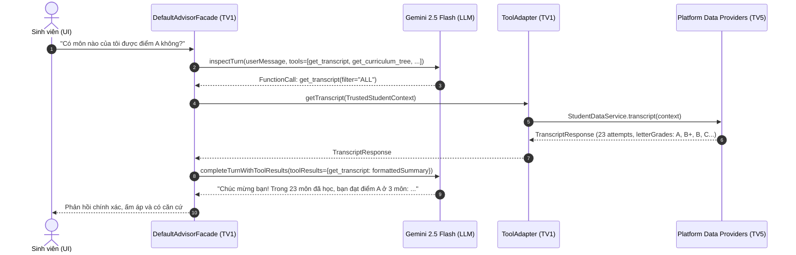

# Spec: Student Journey Tools (`get_transcript` & `get_curriculum_tree`)

## 1. Bối cảnh & Mục tiêu (Context & Objectives)

Hiện tại, trợ lý Cố vấn Học vụ HaUI Advisor (`tv1-ai`) sử dụng Gemini Native Function Calling với 7 công cụ cơ bản. Tuy nhiên, AI mới chỉ nhìn được một lát cắt rời rạc (chỉ số tổng hợp CPA/tín chỉ tích lũy hoặc kiểm tra từng mã môn học đơn lẻ). Khi sinh viên hỏi các câu hỏi khám phá có tính bao quát:
- **Về quá khứ:** *"Tôi đã học những môn gì?", "Có môn nào của tôi được A không?", "Tôi học tốt những môn nào?"*
- **Về tương lai:** *"Kỳ tới tôi được đăng ký những môn nào?", "Tôi còn những môn bắt buộc nào chưa học?", "Môn nào có chuỗi tiên quyết dài cần học sớm để không trễ tốt nghiệp?"*

Chatbot hiện tại phải trả lời thật thà rằng hệ thống chưa hiển thị chi tiết bảng điểm và cây môn học.

**Mục tiêu của Spec:**
Bổ sung 2 công cụ chiến lược theo chuẩn Gemini Tool Declarations:
1. `get_transcript`: Cung cấp lịch sử bảng điểm toàn diện (điểm số từng môn, điểm A/B/C/D/F, học kỳ, tín chỉ).
2. `get_curriculum_tree`: Cung cấp cây chương trình đào tạo toàn cảnh (91 tín chỉ còn lại, phân loại môn đã qua/chưa học, danh sách các môn **đủ điều kiện đăng ký ngay trong kỳ tới** và các chuỗi tiên quyết then chốt).

---

## 2. Kiến trúc & Luồng dữ liệu (Architecture & Data Flow)

### 2.1. Phân chia ranh giới sở hữu (Ownership Boundaries)
- **Module `tv1-ai`:** 
  - Định nghĩa Gemini Tool Declarations (`get_transcript`, `get_curriculum_tree`).
  - Mở rộng giao diện `ToolAdapter` với phương thức đọc dữ liệu bảng điểm và cây CTĐT.
  - Xây dựng bộ trích xuất & cô đọng dữ liệu thông minh (`formatTranscript`, `formatCurriculumTree`) để tối ưu context window và ngăn ngừa hallucination.
  - Điều phối Turn 1 (Tool calling) và Turn 2 (Grounding & Synthesis).
- **Module `tv5-platform`:**
  - Đã có sẵn dữ liệu và service trong `StudentDataService#transcript(context)` và `AcademicApiService#tree(context)`.
  - Cung cấp triển khai provider vào `DefaultToolAdapter` tại composition root (`AdvisorConfig`).

### 2.2. Luồng gọi công cụ (Execution Sequence)


---

## 3. Đặc tả công cụ (Gemini Function Declarations Schema)

### 3.1. Công cụ `get_transcript`
- **Name:** `get_transcript`
- **Description:** `"Tra cứu toàn bộ lịch sử học tập và bảng điểm chi tiết của sinh viên: danh sách các học phần đã học, điểm chữ (A, B, C, D, F), điểm thang 10, số tín chỉ và học kỳ hoàn thành. Dùng khi sinh viên hỏi về các môn đã học, môn điểm cao/thấp, môn điểm A, hoặc phân tích kết quả học tập trong quá khứ."`
- **Parameters:**
  ```json
  {
    "type": "OBJECT",
    "properties": {
      "filter": {
        "type": "STRING",
        "description": "Bộ lọc học phần: 'ALL' (tất cả), 'GRADE_A' (chỉ môn điểm A/A+), 'FAILED' (môn nợ/trượt), 'PASSED' (môn đã qua). Mặc định là 'ALL'."
      }
    }
  }
  ```

### 3.2. Công cụ `get_curriculum_tree`
- **Name:** `get_curriculum_tree`
- **Description:** `"Tra cứu toàn bộ cây chương trình đào tạo (CTĐT) của sinh viên: danh sách các môn chưa học (bắt buộc/tự chọn), danh sách các môn ĐỦ ĐIỀU KIỆN ĐĂNG KÝ trong học kỳ tới, điều kiện tiên quyết và học kỳ gợi ý. Dùng khi sinh viên hỏi về các môn học trong tương lai, kỳ tới nên/được học môn gì, hoặc lộ trình các môn còn lại."`
- **Parameters:**
  ```json
  {
    "type": "OBJECT",
    "properties": {
      "scope": {
        "type": "STRING",
        "description": "Phạm vi tra cứu: 'ELIGIBLE_NEXT_SEMESTER' (các môn đủ điều kiện đăng ký ngay kỳ tới), 'REMAINING_COURSES' (toàn bộ môn chưa học trong CTĐT), 'ALL' (toàn bộ cây CTĐT). Mặc định là 'ELIGIBLE_NEXT_SEMESTER'."
      }
    }
  }
  ```

---

## 4. Định dạng dữ liệu nạp vào Prompt Turn 2 (Smart Summarization)

Tránh nhồi nguyên văn JSON thô 120 môn vào prompt. `LiveAdvisorModel` / `DefaultAdvisorFacade` sẽ format dữ liệu thành bản tóm tắt có cấu trúc:

### 4.1. Đối với `get_transcript`:
```text
<transcript_summary>
- Tổng số môn đã học: 23 môn (59 tín chỉ tích lũy)
- Môn đạt điểm A/A+ (Xuất sắc):
  + IT6011: Nhập môn lập trình (3 tín chỉ, Điểm A)
  + MA6001: Giải tích 1 (3 tín chỉ, Điểm A)
  + PE6001: Giáo dục thể chất 1 (1 tín chỉ, Điểm A)
- Môn đạt điểm B+/B: 14 môn (tiêu biểu: IT6015 Cấu trúc dữ liệu...)
- Môn đạt điểm C+/C/D: 6 môn
- Môn trượt/nợ F: 0 môn
</transcript_summary>
```

### 4.2. Đối với `get_curriculum_tree`:
```text
<curriculum_tree_summary>
- Ngành: Kỹ thuật phần mềm (KTPM) - Khóa: K19
- Tiến độ: Đã hoàn thành 59/150 tín chỉ. Còn lại: 91 tín chỉ.
- CÁC MÔN ĐỦ ĐIỀU KIỆN ĐĂNG KÝ NGAY HỌC KỲ TỚI (Eligible):
  + IT6080: Kiến trúc phần mềm (3 tín chỉ, Học kỳ gợi ý: 5)
  + IT6020: Cơ sở dữ liệu (3 tín chỉ, Học kỳ gợi ý: 4)
  + IT6030: Hệ quản trị cơ sở dữ liệu (3 tín chỉ, Học kỳ gợi ý: 5)
- CÁC MÔN CHƯA ĐỦ ĐIỀU KIỆN (Bị chặn bởi tiên quyết):
  + IT6090: Đồ án chuyên ngành (Thiếu tiên quyết IT6080)
- NÚT THẮT TIÊN QUYẾT (Khuyến nghị đăng ký sớm): IT6020 vì là điều kiện tiên quyết của 4 môn chuyên ngành tiếp theo.
</curriculum_tree_summary>
```

---

## 5. Quy tắc Grounding & Chống ảo giác (Grounding Rules)

1. **Tuyệt đối không bịa đặt điểm số:** LLM chỉ được phép khẳng định sinh viên đạt điểm A ở những môn có trong `<transcript_summary>`.
2. **Tuyệt đối không xác nhận môn đủ điều kiện nếu chưa qua tiên quyết:** Chỉ những môn được liệt kê trong mục `Eligible` mới được tư vấn là "đủ điều kiện đăng ký".
3. **Giữ vững văn phong Cố vấn Học vụ:** Nhiệt tình, ấm áp, hóm hỉnh và luôn đưa ra lời khuyên hành động thiết thực (Actionable Advice).
