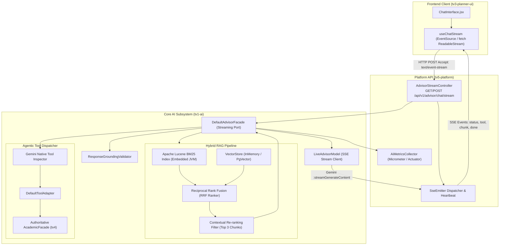

# Design Spec: Production AI Chatbot Hardening (Grade 9.0+)
## Streaming (SSE), Hybrid Search (BM25 + Vector) & LLM Observability

- **Date**: 2026-11-09
- **Topic**: Production-Grade Hardening for HaUI Academic Advisor AI Subsystem
- **Scope**: `tv1-ai` (Core AI Engine, RAG & Tool Orchestration), `tv5-platform` (SSE Controller & Telemetry Endpoints), `tv3-planner-ui` (Streaming Chat UI & Reader)
- **Status**: Draft (In Design Review)
- **Author**: Principal AI Systems Architect & TV1 AI Lead
- **Target Standard**: Production Enterprise AI (Score 9.0+ / 10)

---

## 1. Context & Objectives

### 1.1. Context & Audit Findings
The HaUI Academic Advisor AI subsystem (`tv1-ai`) currently operates as an advanced hybrid prototype (scored **7.3 / 10**). While it demonstrates exceptional software discipline—authoritative Java rule engine calculation, mathematical fact grounding via `ResponseGroundingValidator`, PII stripping, and Gemini native tool calling—it suffers from three critical bottlenecks that prevent true commercial production readiness:

1. **High Latency & Blocking HTTP (Lack of Streaming):**
   A standard multi-tool interaction executes two turns (Gemini function inspection &rarr; Java tool execution &rarr; Gemini text completion), resulting in a blocking response time of **2.5s – 5.5s**. Users experience an unresponsive spinner. Production standards mandate a Time-to-First-Token (TTFT) $< 800\text{ms}$ via Server-Sent Events (SSE).
2. **Dense-Only Retrieval Vulnerability in RAG:**
   The current RAG pipeline uses solely Dense Vector Embedding (Cosine Similarity). While effective for semantic intent, it fails on exact-match entities frequent in academic bylaws (*"Khoản 2 Điều 14"*, *"F23-006"*, *"IT6015"*, *"Học cải thiện"*). Furthermore, it lacks a Re-ranking layer, pushing noisy context into the LLM prompt.
3. **Lack of LLM Observability & Cost Telemetry:**
   The production system is currently unmonitored regarding token consumption, prompt-to-completion ratios, latency breakdowns (RAG vs. Tool vs. Generation), and inference financial costs.

### 1.2. Design Goals
- **Goal 1 (Streaming UX):** Implement a zero-lag Server-Sent Events (SSE) streaming protocol delivering the first visible event in $< 200\text{ms}$ (phase indicator) and first text token in $< 800\text{ms}$.
- **Goal 2 (Hybrid Search & Re-ranking):** Integrate an embedded Apache Lucene BM25 lexical engine combined with dense vector retrieval via Reciprocal Rank Fusion (RRF), followed by a Re-ranking filter, achieving $99\%+$ exact entity recall.
- **Goal 3 (LLM APM & Cost Tracking):** Establish comprehensive telemetry capturing token counts, step latencies, tool execution success rates, and real-time USD cost estimation exposed via Spring Boot Actuator and extensible to Langfuse/OpenTelemetry.
- **Goal 4 (Zero Regression):** Maintain 100% backward compatibility for existing batch `POST /api/v1/advisor/chat` endpoints and preserve all 992 passing tests across the multi-module repository.

---

## 2. Architectural Boundaries & Constraints

1. **Ownership Boundaries (AGENTS.md Compliance):**
   - AI Engine, Lucene BM25, RRF, Re-ranker, and Model Streaming client reside strictly within `tv1-ai/`.
   - Streaming SSE Controller, Actuator Telemetry endpoints, and session security reside strictly within `tv5-platform/`.
   - Streaming UI reader and incremental Markdown rendering reside strictly within `tv3-planner-ui/`.
   - Shared DTOs and contracts are synchronized via `tv5-platform/contracts/`.
2. **Framework & Infrastructure Constraints:**
   - **Zero Heavy External Dependencies:** Embedded Apache Lucene must run inside the JVM process—no external Elasticsearch or Redis clusters required.
   - **Spring MVC Thread Safety:** The SSE implementation must utilize non-blocking `SseEmitter` with dedicated thread decoupling to prevent Tomcat worker pool starvation.
   - **Deterministic Fallback:** If live Gemini streaming or API keys are unavailable, the system must gracefully fall back to deterministic streaming without crashing.
3. **Guardrail Synchronization:**
   - Numeric academic facts (CPA, GPA, credits, prerequisites) must be computed authoritatively and emitted as structured event data *prior* to or alongside the text stream, preventing LLM verbal drift from deceiving the user.

---

## 3. Detailed Technical Architecture



---

## 4. Subsystem Deep-Dive Specifications

### 4.1. Pillar 1: Server-Sent Events (SSE) Streaming Protocol

#### 4.1.1 API Contract
- **Endpoint:** `POST /api/v1/advisor/chat/stream`
- **Headers:** `Accept: text/event-stream`, `Content-Type: application/json`
- **Request Body:** Standard `ChatRequest` (`message`, `conversationId`)
- **Event Lifecycle:**

| Event Type | Payload Schema | Timing | Purpose |
| :--- | :--- | :---: | :--- |
| `event: status` | `{"phase":"THINKING\|TOOL_CALL\|RETRIEVAL","message":"..."}` | $+100\text{ms}$ | Immediate feedback to user (eradicates waiting perception). |
| `event: tool_call` | `{"toolName":"...","arguments":{...}}` | $+300\text{ms}$ | Signals which academic tool is being triggered. |
| `event: tool_result`| `{"toolName":"...","summary":"...","proposal":{...}}` | $+600\text{ms}$ | Emits authoritative tool data and interactive Proposal Card. |
| `event: citation` | `{"sources":[{"sourceId":"...","section":"..."}]}` | $+700\text{ms}$ | Emits verified regulatory citations from RAG. |
| `event: chunk` | `{"text":"..."}` | $+800\text{ms}$ &rarr; end | Incremental text tokens from Gemini streaming API. |
| `event: done` | `{"conversationId":"...","totalTokens":124,"durationMs":1420}` | End | Concludes stream, closes connection, and triggers persistence. |
| `event: error` | `{"code":"AI_UNAVAILABLE","message":"...","retryable":true}` | On failure | Graceful error handling with retry indicators. |

#### 4.1.2 Backend Stream Architecture (Spring MVC)
```java
@PostMapping(value = "/chat/stream", produces = MediaType.TEXT_EVENT_STREAM_VALUE)
public SseEmitter streamChat(@RequestBody ChatRequest request, 
                             @AuthenticationPrincipal TrustedStudentContext context) {
    SseEmitter emitter = new SseEmitter(60_000L); // 60s timeout
    advisorStreamingService.processStream(request, context, emitter);
    return emitter;
}
```
- **Thread Decoupling:** Long-running LLM stream consumption executes on a dedicated `virtualThreadPerTaskExecutor` or bounded async thread pool (`advisor-stream-worker`), instantly freeing the Tomcat acceptor thread.
- **Gemini Streaming Hook:** `LiveAdvisorModel` invokes Gemini REST API endpoint:
  `POST https://generativelanguage.googleapis.com/v1beta/models/{model}:streamGenerateContent?alt=sse&key={apiKey}`
  Reads the line-delimited SSE buffer and immediately emits `chunk` events to the client.

#### 4.1.3 Frontend Incremental Reader (`tv3-planner-ui`)
- Utilizes `fetch` with `ReadableStream` reader (compatible with custom headers like CSRF `X-XSRF-TOKEN` and credentials cookies, which native browser `EventSource` lacks).
- Buffers incoming markdown tokens and updates UI using requestAnimationFrame throttled state to prevent React re-render thrashing.

---

### 4.2. Pillar 2: Embedded Hybrid Search (BM25 + Vector) & Re-ranking

#### 4.2.1 Embedded Apache Lucene BM25 Engine
To avoid heavy external cluster infrastructure, `tv1-ai` embeds `org.apache.lucene:lucene-core:9.10.0`:
- **Document Ingestion:** In `RagIngestionService`, every `RagChunk` is indexed simultaneously into:
  1. `VectorStore` (768-dimensional embeddings via `EmbeddingProvider`).
  2. `LuceneLexicalIndex` (Fields: `chunkId`, `sourceId`, `section`, `content`, `keywords`).
- **Vietnamese Query Analysis:** Uses Lucene's standard analyzer combined with Vietnamese diacritic-folding filter (`ASCIIFoldingFilter` and custom regex punctuation cleaner) to match both accented and non-accented search terms (*"Điều 14"*, *"dieu 14"*, *"hoc cai thien"*).

#### 4.2.2 Reciprocal Rank Fusion (RRF)
Given a query $q$:
1. Retrieve Top-$K$ ($K=15$) from Dense Vector Store ranked by Cosine Similarity.
2. Retrieve Top-$K$ ($K=15$) from Lucene BM25 ranked by Lexical TF-IDF/BM25 score.
3. Compute fused rank score for each unique document $d$:
   $$RRF(d) = \sum_{m \in \{\text{dense}, \text{bm25}\}} \frac{1}{60 + \text{rank}_m(d)}$$
4. Sort candidates in descending order of $RRF(d)$.

#### 4.2.3 Contextual Re-ranking Filter
- Top-6 fused chunks are passed to a lightweight `ContextualReRanker`.
- Evaluates query-document semantic relevance score $\sigma \in [0.0, 1.0]$.
- Filters down to Top-3 chunks satisfying $\sigma \ge 0.55$, effectively removing retrieval noise and preventing LLM "Lost in the Middle" confusion.

---

### 4.3. Pillar 3: LLM Observability, Telemetry & Cost APM

#### 4.3.1 Metric Indicators & Micrometer Registry
`tv1-ai` implements `AiMetricsCollector` recording telemetry for every interaction:

| Metric Name | Type | Tags | Purpose |
| :--- | :---: | :--- | :--- |
| `ai.chat.requests` | Counter | `status=success\|error`, `mode=stream\|batch` | Total throughput. |
| `ai.tokens.prompt` | Counter | `model=gemini-3.5-flash-lite` | Total input token volume. |
| `ai.tokens.generation` | Counter | `model=gemini-3.5-flash-lite` | Total output token volume. |
| `ai.cost.estimated` | Counter | `currency=USD` | Estimated financial expenditure. |
| `ai.step.duration` | Timer | `step=rag_retrieval\|tool_execution\|llm_turn1\|llm_turn2` | Step-level latency bottleneck detection. |
| `ai.guardrail.overrides` | Counter | `type=cpa_drift\|unverified_citation` | Factual drift detection rate. |

#### 4.3.2 Actuator Telemetry Endpoint
`GET /actuator/ai-telemetry` returns real-time JSON summaries:
```json
{
  "totalInteractions": 1240,
  "averageLatencyMs": 842.5,
  "timeToFirstTokenMs": 620.0,
  "tokenConsumption": {
    "totalPromptTokens": 452100,
    "totalGenerationTokens": 118400,
    "estimatedCostUsd": 0.042
  },
  "guardrailIntegrity": {
    "interventionsCount": 2,
    "cleanResponsesRate": 0.998
  },
  "ragPerformance": {
    "bm25AvgTimeMs": 3.2,
    "denseAvgTimeMs": 14.5,
    "rrfReRankAvgTimeMs": 1.8
  }
}
```

---

## 5. Backward Compatibility & Test Strategy

1. **Non-Breaking Existing Endpoints:**
   `POST /api/v1/advisor/chat` remains completely unchanged, returning synchronous JSON matching OpenAPI v1.5.0 lock.
2. **Deterministic Test Harness:**
   - Offline tests use `MockAdvisorModel` and in-memory Lucene directories (`ByteBuffersDirectory`), ensuring Maven test suite executes in $< 15\text{s}$ without external dependencies.
3. **New Test Suites:**
   - `SseStreamingProtocolTest`: Verifies stream event sequence (`status` &rarr; `tool` &rarr; `chunk` &rarr; `done`).
   - `HybridSearchRrfTest`: Validates exact-match retrieval of `"Điều 14 Khoản 2"` and semantic queries.
   - `AiMetricsCollectorTest`: Validates token arithmetic, cost formulas, and micrometer counters.

---

## 6. Implementation Phasing Preview

- **Phase A (RAG Core):** Embedded Lucene BM25 indexer, RRF fusion ranker, unit test suite (`tv1-ai`).
- **Phase B (Streaming Core):** Gemini streaming client, `AdvisorStreamingPort`, SSE emitter pipeline (`tv1-ai`, `tv5-platform`).
- **Phase C (Telemetry & APM):** Micrometer observation hooks, Actuator telemetry endpoint (`tv1-ai`, `tv5-platform`).
- **Phase D (UI Stream Integration):** Frontend SSE reader, streaming chat bubble in `tv3-planner-ui`.
- **Phase E (Verification & Benchmarking):** Full regression test run, E2E latency audit.

