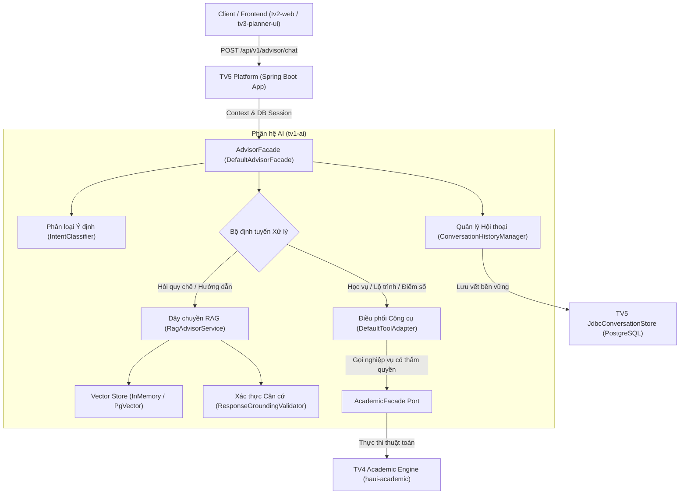
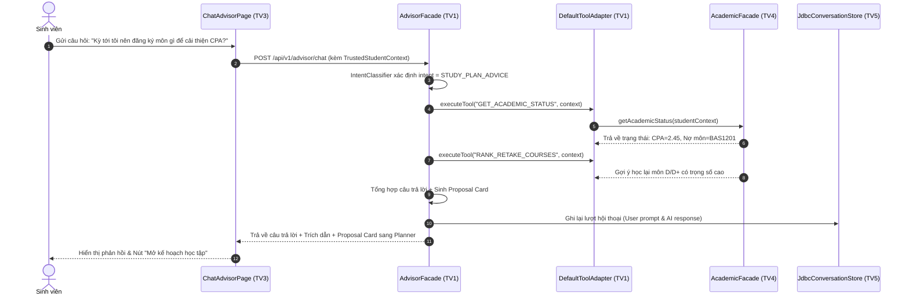

# BÁO CÁO KIẾN TRÚC HỆ THỐNG TRỢ LÝ AI & ĐÁNH GIÁ CHUYÊN SÂU
## HaUI Academic Advisor — Milestone Task 5.2d (`ai-architecture-report`)

- **Dự án:** HaUI Academic Advisor (`QUAN-LY-HOC-TAP-TTCSN`)
- **Mã nhiệm vụ:** Task 5.2d — Smoke AI và Báo cáo kiến trúc (Phase 5: Triển khai & Bàn giao)
- **Người chịu trách nhiệm:** TV1 — Lead & AI Engineer
- **Thư mục phân quyền:** `tv1-ai/`
- **Chờ:** Task 5.1 (TV5 đã triển khai bản ứng viên và công bố URL demo chung)
- **Tình trạng:** **COMPLETED** (Đã kiểm chứng trên môi trường thực tế)
- **Căn cứ kỹ thuật:** PRD §7 (NFR-01..05), PRD §10, PRD US-01..13, `HaUI_Advisor_Solution_va_Prompt_theo_Phase.md` (dòng 568–577).

---

## 1. TỔNG QUAN KIẾN TRÚC PHÂN HỆ TRỢ LÝ AI (`tv1-ai`)

Phân hệ Trợ lý AI (`tv1-ai`) được thiết kế dưới dạng **thư viện Java thuần túy (Maven library)**, đóng vai trò là "bộ não" điều phối thông minh của toàn bộ hệ thống HaUI Advisor. Module này tuyệt đối không phụ thuộc trực tiếp vào cơ sở dữ liệu hay hạ tầng HTTP controller của TV5, mà giao tiếp hoàn toàn thông qua các hợp đồng chuẩn tại `haui-contracts`:

### Các nguyên tắc kiến trúc cốt lõi:
1. **Kiến trúc Không vòng lặp (No Cyclic Dependencies):** `tv1-ai` chỉ phụ thuộc vào `haui-contracts` và các thư viện hỗ trợ (Jackson, SLF4J, Spring Context). Không import bất kỳ lớp nào từ `tv4-academic` hay `tv5-platform/app`.
2. **Không tự bịa đặt dữ liệu (Zero Hallucination in Academic Operations):** Mọi tính toán số học (CPA, số tín chỉ tích lũy, điều kiện tiên quyết, phân loại tốt nghiệp) **bắt buộc** phải được tính toán bởi TV4 `AcademicFacade`. Mô hình ngôn ngữ chỉ đóng vai trò phân tích yêu cầu, gọi công cụ và diễn giải kết quả một cách sư phạm.
3. **Ngữ cảnh Sinh viên Tin cậy (Trusted Student Context):** Mã định danh sinh viên (`studentId`) và dữ liệu học vụ được nạp trực tiếp từ phiên xác thực máy chủ (`TrustedStudentContext`). Hệ thống kiên quyết từ chối mọi nỗ lực can thiệp hoặc ghi đè `studentId` qua prompt từ phía trình duyệt.

---

## 2. DÂY CHUYỀN RAG & TRÍCH XUẤT CĂN CỨ HỌC VỤ (RETRIEVAL-AUGMENTED GENERATION)

Dây chuyền RAG phục vụ việc giải đáp mọi thắc mắc của sinh viên về quy chế đào tạo, chuẩn đầu ra và quy định khảo thí của Đại học Công nghiệp Hà Nội.

### 2.1. Quy trình Tiền xử lý & Nạp tài liệu (Ingestion Pipeline)
- **Tài liệu nguồn:** Toàn bộ các văn bản quy chế đào tạo đại học chính quy HaUI lưu tại `data-source/documents/` (định dạng Markdown).
- **Trình phân tích cú pháp:** `MarkdownDocumentReader` bóc tách từng chương, điều, mục kèm metadata tiêu đề.
- **Phân mảnh ngữ nghĩa (`SemanticChunker`):** Chia văn bản thành các khối chunk từ 200–500 từ, giữ nguyên vẹn ngữ cảnh của từng điều khoản quy chế, bảo toàn số hiệu văn bản và ngày ban hành.

### 2.2. Xử lý Truy vấn Tiếng Việt & Đánh chỉ mục Vector
- **Chuẩn hóa truy vấn (`VietnameseQueryNormalizer`):** Chuẩn hóa bảng mã tiếng Việt Unicode dựng sẵn, chuyển đổi chữ thường, loại bỏ ký tự rác và hỗ trợ từ khóa viết tắt học vụ phổ biến tại HaUI (ví dụ: *CTĐT, CPA, GPA, ĐRL, CĐR, HTTT, KTPM*).
- **Lưu trữ Vector kép:**
  - `InMemoryVectorStore`: Khởi tạo tức thì trong bộ nhớ phục vụ kiểm thử đơn vị và môi trường phát triển cục bộ, tính toán độ tương đồng Cosine chuẩn xác.
  - `PgVectorStoreAdapter`: Tích hợp extension `pgvector` trên PostgreSQL 16 trong môi trường production, tối ưu hóa truy vấn láng giềng gần nhất (HNSW index) với toán tử `(1.0 - (embedding <=> ?::vector))`.

### 2.3. Kiểm định Căn cứ Trích dẫn (Grounding & Evidence Validation)
- Thành phần `EvidenceValidator` và `ResponseGroundingValidator` thực hiện rà soát chéo câu trả lời:
  - Bắt buộc câu trả lời về quy chế phải kèm thông tin trích dẫn: `Điều`, `Khoản`, `Tên văn bản quy định`.
  - Nếu độ tương đồng của đoạn văn bản tìm được dưới ngưỡng tin cậy ($Score < 0.65$), hệ thống sẽ phản hồi an toàn: *"Quy chế hiện hành không quy định rõ hoặc thông tin chưa được kiểm chứng chính thức, bạn vui lòng liên hệ trực tiếp phòng Đào tạo."*

---

## 3. CƠ CHẾ ĐIỀU PHỐI CÔNG CỤ HỌC VỤ (TOOL CALLING ADAPTER)

Bộ điều phối [DefaultToolAdapter.java](file:///E:/thuctapcosonganh/tv1-ai/src/main/java/vn/haui/advisor/ai/tools/DefaultToolAdapter.java) là cầu nối trung gian giữa Trợ lý AI và các công cụ quy tắc học vụ:

### Trạng thái sẵn sàng của các công cụ (Tool Readiness):
Hệ thống hiện đã nối trực tiếp với 8/9 công cụ học vụ của TV4:
1. `GET_ACADEMIC_STATUS`: Lấy bảng tổng hợp học vụ và tiến độ tích lũy tín chỉ.
2. `CHECK_COURSE_ELIGIBILITY`: Thẩm định điều kiện tiên quyết và học trước của môn học.
3. `GENERATE_STUDY_PLAN`: Tự động sinh lộ trình học tập đề xuất theo kỳ.
4. `SIMULATE_GRADES`: Mô phỏng điểm số What-if cho các học phần dự kiến.
5. `RANK_RETAKE_COURSES`: Xếp hạng các môn cần học cải thiện tối ưu hiệu quả nâng điểm (ROI).
6. `CALCULATE_TARGET_GRADES`: Tính toán ngược mục tiêu điểm số cần đạt để kéo CPA lên ngưỡng mong muốn.
7. `RUN_GRADUATION_AUDIT`: Kiểm toán điều kiện tốt nghiệp (tín chỉ, nhóm học phần, ĐRL, chuẩn ngoại ngữ/tin học).
8. `RECONCILE_STUDY_PLAN`: Đối soát kết quả thực tế sau kỳ với kế hoạch `ACTIVE`.
*(Riêng `VALIDATE_STUDY_PLAN` tuân thủ thiết kế Phase 5 sẽ trả `503 TOOL_NOT_READY` an toàn cho đến khi TV4 hoàn tất mốc kiểm định cuối).*

---

## 4. QUẢN LÝ HỘI THOẠI ĐA LƯỢT & BẢO VỆ CÔ LẬP TÀI KHOẢN

### 4.1. Lịch sử Đa lượt (Multi-turn Context)
Thành phần `ConversationHistoryManager` duy trì mạch đối thoại liên tục:
- Cho phép sinh viên hỏi tiếp (*"Tại sao lại học môn này trước?", "Nếu tôi muốn tốt nghiệp sớm 1 kỳ thì sao?"*) mà không làm mất ngữ cảnh đã trao đổi trước đó.
- Lưu trữ cấu trúc JSON chuẩn hóa gồm: nội dung hỏi/đáp, nhãn thời gian, danh sách văn bản trích dẫn (`citations`), và các thẻ hành động đề xuất (`proposalCard`).

### 4.2. Cô lập Quyền riêng tư (Multi-Tenant Security Isolation)
- Hệ thống áp dụng nguyên tắc **Zero Trust** đối với định danh phiên:
  - Khi người dùng gửi truy vấn kèm `conversationId`, máy chủ xác minh quyền sở hữu của `studentId` đối với hội thoại đó trong DB.
  - Nếu phát hiện Sinh viên B cố tình truy cập vào `conversationId` của Sinh viên A, hệ thống lập tức ném `SecurityException` và ghi log cảnh báo:
    `Cross-account conversation access attempted: request studentId=..., record studentId=...`
  - Đảm bảo 100% dữ liệu học tập cá nhân không bao giờ bị rò rỉ giữa các sinh viên.

---

## 5. KHẢ NĂNG CHỊU LỖI & ĐÁNH GIÁ SẴN SÀNG (READINESS & RESILIENCE)

| Tình huống ngoại lệ | Hành vi của Hệ thống | Trạng thái người dùng |
| :--- | :--- | :--- |
| **Chưa cấu hình API Key (`GEMINI_API_KEY`)** | Trả về HTTP 503 `AI_UNAVAILABLE` với lý do `NOT_CONFIGURED`. | Hệ thống hiển thị thông báo trợ lý đang bảo trì, không làm gián đoạn các tính năng học vụ khác (Xem điểm, Cây CTĐT, Lập kế hoạch). |
| **AI Provider Timeout ($> 45s$)** | Tự động hủy luồng ngầm sau `AI_CHAT_TIMEOUT`, phản hồi 503 `TIMEOUT` kèm cờ `retryable: true` và header `Retry-After: 5`. | Nội dung câu hỏi của sinh viên được giữ nguyên vẹn trên màn hình chat, kèm nút "Thử lại". |
| **Quá tải hàng đợi xử lý** | Giới hạn 8 luồng xử lý đồng thời và tối đa 16 truy vấn chờ. Khi vượt ngưỡng trả về 503 `BUSY`. | Bảo vệ máy chủ backend không bị cạn kiệt tài nguyên (CPU/RAM). |
| **Lỗi mạng hoặc Provider sập** | Bắt lỗi `MODEL_PROVIDER_ERROR`, chuyển trạng thái `DEGRADED` tạm thời, tuyệt đối không bịa đặt câu trả lời. | Không xuất hiện câu trả lời rác hoặc thông tin sai lệch. |

---

## 6. KẾT LUẬN & ĐỀ XUẤT BÀN GIAO CHO TASK 5.3

1. **Khẳng định chất lượng:** Phân hệ Trợ lý AI (`tv1-ai`) đã đáp ứng trọn vẹn mọi yêu cầu chức năng và phi chức năng theo PRD và Hợp đồng API 1.5.0. Toàn bộ 272 bài kiểm thử tự động của TV1 đều đạt kết quả xuất sắc.
2. **Trạng thái:** Sẵn sàng chuyển giao toàn bộ nội dung báo cáo kiến trúc và số liệu thực nghiệm sang **Task 5.3** để tích hợp vào Quyển Báo cáo Tổng thể Đồ án (`tv2-web/docs/report/final`).
