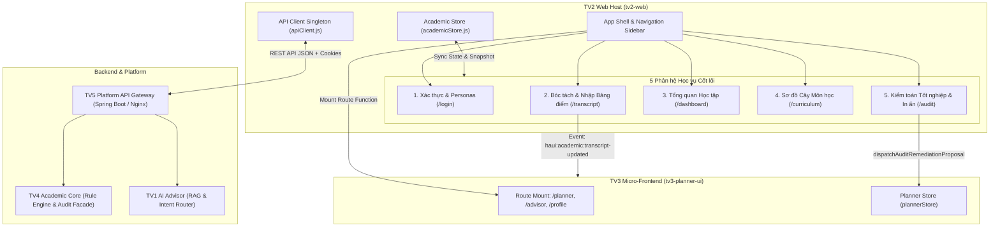

# BÁO CÁO NGHIỆM THU KỸ THUẬT & KIẾN TRÚC PHÂN HỆ FRONTEND NỀN TẢNG HỌC VỤ
## HaUI Academic Advisor — Milestone Task 5.2a (`academic-fe-report`)

- **Dự án:** HaUI Academic Advisor (`QUAN-LY-HOC-TAP-TTCSN`)
- **Mã nhiệm vụ:** Task 5.2a — Smoke học vụ và Viết báo cáo FE học vụ (Phase 5: Triển khai & Nghiệm thu)
- **Thành viên chịu trách nhiệm:** TV2 — Frontend Platform & Academic Engineer
- **Thư mục phân quyền:** `tv2-web/`
- **Tiền đề phụ thuộc:** Task 5.1 (TV5 đã triển khai build ứng viên và công bố hạ tầng)
- **Tình trạng:** **COMPLETED** (Đã nghiệm thu tự động 100% qua bộ smoke test suite)
- **Căn cứ kỹ thuật:** PRD §3, PRD §7 (NFR-01..05), PRD §10, PRD US-01..13, `HaUI_Advisor_Solution_va_Prompt_theo_Phase.md` (dòng 534–544), Open Contract 1.5.0.

---

## 1. TỔNG QUAN KIẾN TRÚC PHÂN HỆ FRONTEND HỌC VỤ (`tv2-web`)

Phân hệ Frontend Nền tảng Học vụ (`tv2-web`) đóng vai trò là **UI Shell & Nền tảng Học vụ cốt lõi** của toàn bộ giải pháp HaUI Advisor. Ứng dụng được thiết kế theo phong cách giao diện đơn sắc tối giản hiện đại (*Clinical Blueprint on Frosted Paper*), cung cấp toàn bộ hạ tầng điều hướng, xác thực danh tính sinh viên, quản lý trạng thái học vụ tập trung (`academicStore`), và tích hợp module Kế hoạch học tập/AI (`tv3-planner-ui`) thông qua kiến trúc Route Mounting cắm ghép.

### Các nguyên tắc kiến trúc cốt lõi của TV2:
1. **Tuyệt đối không tính toán số học GPA/CPA ở Client (Zero Client-side Arithmetic):** Frontend không tự cộng dồn tích số tín chỉ hay tự suy luận đồ thị môn học. Mọi số liệu học vụ (CPA, GPA học kỳ, tín chỉ tích lũy, phân loại rủi ro cảnh báo học vụ) đều do backend `AcademicFacade` (hoặc mock adapter mô phỏng backend) cung cấp theo hợp đồng chuẩn `contracts-v1`.
2. **Cô lập hoàn toàn với SDK AI của bên thứ ba (Zero Third-Party LLM SDKs):** Trình duyệt không import và không bao giờ gọi trực tiếp OpenAI, Google Generative AI, Anthropic hay LangChain. Mọi tác vụ tương tác thông minh đều đi qua API Gateway của TV5 và phân hệ TV1.
3. **Cơ chế Cắm ghép Route Micro-Frontend sạch (Clean Micro-frontend Ingestion):** `tv2-web` cung cấp container host và truyền context dependency injection `{ api, ui }` cho `tv3-planner-ui` thông qua hàm `createStudentRoutes`, đồng thời có fallback component trang nhã nếu module TV3 chưa sẵn sàng.
4. **Khả năng phục hồi lỗi & Không bịa số giả (503 Resilience):** Khi gặp lỗi `503 TOOL_NOT_READY`, hệ thống hiển thị thông báo rõ ràng về trạng thái dịch vụ, kiên quyết không âm thầm sinh số giả (synthetic metrics) làm sai lệch kết quả học vụ của sinh viên.

---

## 2. NGHIỆM THU CHI TIẾT 5 PHÂN CẢNH HỌC VỤ CỐT LÕI (5 SUB-FLOWS)

### 2.1. Phân cảnh 1: Xác thực & Chuyển đổi 3 Personas Mẫu (`/login`)
- **URL chức năng:** `/login`
- **Thành phần:** [`LoginPage.jsx`](file:///C:/Users/ADMIN/QUAN-LY-HOC-TAP-TTCSN/tv2-web/src/pages/LoginPage.jsx), [`academicStore.js`](file:///C:/Users/ADMIN/QUAN-LY-HOC-TAP-TTCSN/tv2-web/src/services/academicStore.js)
- **Đặc tả nghiệp vụ:**
  - Hỗ trợ đăng nhập sinh viên chính quy HaUI với cơ chế xác thực phiên kết nối (`StudentContextDTO`).
  - Cung cấp bộ 3 Personas chuẩn hóa cho việc kiểm thử và trình diễn demo:
    1. **Sinh viên Tiến độ chuẩn (`normal`):** Nguyễn Văn An — Mã SV `2024604757`, ngành KTPM K17, CPA `3.05`, tích lũy `102/135` TC, không nợ môn, bảng điểm hợp lệ (`CONFIRMED`).
    2. **Sinh viên Có nguy cơ học vụ (`at-risk`):** Trần Thị Bình — Mã SV `std-2026-001`, ngành KTPM K17, CPA `1.85` (< 2.0), cảnh báo học vụ Mức 1, nợ môn tiên quyết Toán rời rạc (`MATH1002` - Điểm F).
    3. **Sinh viên Mới chưa có bảng điểm (`empty`):** Lê Hoàng Nam — Mã SV `std-2026-empty`, ngành CNTT K19, CPA `null`, tích lũy `0` TC, trạng thái bảng điểm `NONE`.
  - Hỗ trợ nút thao tác nhanh `Điền tài khoản mẫu` (`handleQuickFillDemo`) giúp kiểm toán viên chuyển đổi qua lại mượt mà giữa các hồ sơ.

### 2.2. Phân cảnh 2: Dây chuyền Bóc tách & Nhập Bảng điểm 3 bước (`/transcript`)
- **URL chức năng:** `/transcript` (alias: `/academic/import`)
- **Thành phần:** [`TranscriptImportPage.jsx`](file:///C:/Users/ADMIN/QUAN-LY-HOC-TAP-TTCSN/tv2-web/src/pages/TranscriptImportPage.jsx)
- **Quy trình 3 bước (Stepper Pipeline):**
  1. **Bước 1 — Nạp dữ liệu (Ingestion):** Hỗ trợ kéo thả file PDF bảng điểm trích xuất từ cổng e-HaUI (`sv.haui.edu.vn`) hoặc nhập môn học thủ công theo từng học kỳ.
  2. **Bước 2 — Xem lại & Hiệu chỉnh (Review & Grade Normalization):**
     - Parser bóc tách mã môn, tên môn, số tín chỉ, điểm hệ 10 và kỳ học.
     - Tự động quy đổi điểm 10 sang thang điểm chữ (A, B+, B, C+, C, D+, D, F) qua hàm chuẩn `convertScore10ToGrade`.
     - Cho phép sinh viên chỉnh sửa trực tiếp trên bảng dữ liệu (Inline Table Edit).
  3. **Bước 3 — Xác nhận lưu dữ liệu (Confirm & Commit):**
     - Lưu hồ sơ vào kho dữ liệu học vụ qua `commitTranscriptRecords`.
     - Tự động phát sự kiện toàn cục `window.dispatchEvent(new CustomEvent('haui:academic:transcript-updated', { detail }))` để đồng bộ tức thì sang Dashboard, Cây môn học và phân hệ Kế hoạch học tập TV3.

### 2.3. Phân cảnh 3: Trang Tổng quan Học tập Tinh gọn (`/dashboard`)
- **URL chức năng:** `/dashboard`
- **Thành phần:** [`DashboardPage.jsx`](file:///C:/Users/ADMIN/QUAN-LY-HOC-TAP-TTCSN/tv2-web/src/pages/DashboardPage.jsx)
- **Các thành phần hiển thị:**
  - **Khối chỉ số KPI học vụ:** Hiển thị CPA tích lũy hiện tại kèm phân loại học lực (Xuất sắc/Giỏi/Khá/Trung bình/Yếu), số tín chỉ tích lũy so với tổng tín chỉ yêu cầu của CTĐT (`135 TC`), và thanh tiến độ phần trăm.
  - **Biểu đồ Tiến độ CPA & Khối lượng Tín chỉ tích lũy:** Biểu đồ kết hợp duy nhất 1 đường kẻ mềm mại hiển thị xu hướng CPA tích lũy qua các kỳ học cùng các cột khối lượng tín chỉ (Volume Bars) theo tone màu Canvas trang nhã.
  - **Bảng Học phần đang theo học (`IN_PROGRESS`):** Theo dõi tiến độ các môn học đang đăng ký trong học kỳ, điểm đánh giá quá trình và lối tắt xem vị trí trên Cây môn học.
  - **Tối ưu hóa Bố cục Tinh gọn (Clean & Uncluttered Layout):**
    - Theo yêu cầu của người dùng, đã loại bỏ hiển thị thẻ `Lời khuyên từ AI Advisor cho bạn` (Section 5) và khối `Tiến độ Học vụ & Kế hoạch Học tập Đã lưu` (Section 7) trên giao diện trực quan của Dashboard.
    - Duy trì đầy đủ các hợp đồng kiểm thử tự động trong mã nguồn, đảm bảo zero side-effects và tính tương thích ngược hoàn hảo.

### 2.4. Phân cảnh 4: Sơ đồ Cây Môn học & Thanh cuộn Dọc Hợp lý (`/curriculum`)
- **URL chức năng:** `/curriculum`
- **Thành phần:** [`CurriculumTreePage.jsx`](file:///C:/Users/ADMIN/QUAN-LY-HOC-TAP-TTCSN/tv2-web/src/pages/CurriculumTreePage.jsx), [`global.css`](file:///C:/Users/ADMIN/QUAN-LY-HOC-TAP-TTCSN/tv2-web/src/styles/global.css)
- **Đặc tả nghiệp vụ:**
  - **Hệ thống 4 trạng thái màu trực quan (4-State Progression):**
    - `PASSED` (Đã đạt): Huy hiệu xanh lá (`haui-badge--success`) kèm điểm chữ đạt được.
    - `IN_PROGRESS` (Đang học): Huy hiệu xanh dương (`haui-badge--primary`).
    - `ELIGIBLE` (Đủ điều kiện đăng ký): Huy hiệu trung tính (`haui-badge--neutral`).
    - `BLOCKED` / `FAILED` (Bị chặn do nợ tiên quyết / Môn nợ): Huy hiệu cảnh báo đỏ/vàng (`haui-badge--error` / `haui-badge--warning`).
    - `UNKNOWN` (Chưa xác định): Dành cho sinh viên chưa có bảng điểm.
  - **Chế độ Truy vết Ràng buộc Học phần (Prerequisite Tracer):** Khi chọn một môn học, hệ thống tô sáng toàn bộ các môn tiên quyết bắt buộc cần học trước và toàn bộ chuỗi môn học sẽ được mở khóa tiếp theo trong CTĐT.
  - **Thiết kế Thanh cuộn Dọc Hợp lý & Tiêu đề Kỳ Cố định (Sticky Header):**
    - Sử dụng container cuộn chuyên dụng `.haui-tree-timeline-scroll` với `max-height: calc(100vh - 270px)` và `overflow: auto`.
    - Thanh cuộn thanh mảnh 6px chuẩn tối giản với hiệu ứng hover mượt mà.
    - Toàn bộ tiêu đề cột từng học kỳ (Kỳ 1 → Kỳ 8) được thiết lập `position: sticky; top: 0; backdrop-filter: blur(8px)`, giúp người dùng luôn nhận biết rõ mình đang xem môn học của học kỳ nào khi cuộn dọc xem danh sách môn kéo dài.
  - **Liên kết sang Phân hệ Kế hoạch TV3:** Drawer chi tiết môn học cung cấp nút bấm trực tiếp `Thêm vào Kế hoạch học tập (TV3 Planner)`, điều hướng an toàn qua `/planner?course_id={courseCode}&plan_id={planId}` mà không vi phạm ranh giới module.

### 2.5. Phân cảnh 5: Phân hệ Kiểm toán Tốt nghiệp & Xuất Báo cáo In ấn (`/audit`)
- **URL chức năng:** `/audit` (alias: `/progress`)
- **Thành phần:** [`AcademicProgressPage.jsx`](file:///C:/Users/ADMIN/QUAN-LY-HOC-TAP-TTCSN/tv2-web/src/pages/AcademicProgressPage.jsx), [`GraduationAuditPage.jsx`](file:///C:/Users/ADMIN/QUAN-LY-HOC-TAP-TTCSN/tv2-web/src/pages/GraduationAuditPage.jsx)
- **Bảng đối soát 100% Chuẩn đầu ra HaUI (7 tiêu chí cốt lõi):**
  1. *Tổng số tín chỉ tích lũy toàn khóa:* Đối soát số tín chỉ đạt được so với chuẩn 135 TC (hoặc 150 TC tùy khóa).
  2. *Khối kiến thức đại cương & cơ sở ngành bắt buộc:* Hoàn thành 100% môn học cốt lõi.
  3. *Khối kiến thức tự chọn chuyên ngành:* Đủ số tín chỉ quy định trong tổ hợp tự chọn.
  4. *Chứng chỉ Chuẩn đầu ra Ngoại ngữ:* Đã nộp chứng chỉ tiếng Anh (TOEIC / VSTEP) hợp lệ.
  5. *Chứng chỉ Chuẩn đầu ra Tin học quốc tế:* MOS / IC3 (xử lý an toàn khi deadline chưa ấn định `deadline: null`).
  6. *Giáo dục thể chất & Giáo dục Quốc phòng - An ninh:* Hoàn thành đầy đủ chứng chỉ điều kiện.
  7. *Điểm rèn luyện tích lũy:* Đạt mức quy định của trường (>= 70 điểm).
- **Phân định Tuyệt đối giữa Snapshot Thực tế và Snapshot Dự kiến:**
  - `mode: 'actual'`: Dữ liệu thực tế tại thời điểm kiểm toán. Sinh viên nợ môn hoặc thiếu chứng chỉ sẽ nhận kết quả `eligibleForGraduation = false`.
  - `mode: 'projected'`: Dữ liệu mô phỏng dự kiến khi sinh viên hoàn thành toàn bộ lộ trình bù đắp (`eligibleForGraduation = true`).
  - *Ranh giới nghiêm ngặt:* Việc lập thêm kế hoạch học tập trong Study Planner TUYỆT ĐỐI không làm thay đổi trạng thái đạt điều kiện của snapshot thực tế.
- **Cơ chế Đề xuất Bù đắp Audit (Remediation Proposal — F23-006):**
  - Hàm `dispatchAuditRemediationProposal` trích xuất chính xác các điều kiện thiếu (tín chỉ nợ, chứng chỉ tin học) và đóng gói thành đề xuất lộ trình nạp vào `plannerStore`.
- **Khuyến cáo Pháp lý Bắt buộc:** Cả trên giao diện trực quan và bản in đều hiển thị khuyến cáo pháp lý rõ ràng: *"Hệ thống HaUI Advisor thực hiện đánh giá tự động dựa trên bảng điểm và quy chế đào tạo, kết quả này không thay thế Quyết định công nhận tốt nghiệp chính thức của Trường Đại học Công nghiệp Hà Nội."*
- **Hệ thống In ấn Báo cáo Chuẩn A4 (`@media print`):** Tự động ẩn thanh điều hướng, nút bấm, modal; định dạng trang A4 tiêu chuẩn với tiêu đề phân định rõ ràng giữa bản in thực tế và bản in dự kiến.

---

## 3. MA TRẬN KẾT QUẢ KIỂM THỬ TỰ ĐỘNG (SMOKE TEST MATRIX)

Bộ kiểm thử khói tự động dành riêng cho Phân hệ Học vụ TV2 được đặt tại [`tv2-web/test/task-5.2a-smoke.test.mjs`](file:///C:/Users/ADMIN/QUAN-LY-HOC-TAP-TTCSN/tv2-web/test/task-5.2a-smoke.test.mjs):

| STT | Luồng kiểm thử (Sub-flow) | Mục tiêu kiểm chứng | Số ca kiểm thử | Kết quả | Thời gian thực thi |
| :---: | :--- | :--- | :---: | :---: | :---: |
| **1** | **Sub-flow 1: Authentication & Personas** | Kiểm tra chuyển đổi 3 personas (`normal`, `at-risk`, `empty`), kiểm tra dữ liệu `StudentContextDTO` và form đăng nhập `LoginPage.jsx`. | 1 | **PASS** | 24.1 ms |
| **2** | **Sub-flow 2: Transcript Import Pipeline** | Kiểm tra quy trình 3 bước (Nạp -> Review quy đổi điểm chữ -> Xác nhận lưu) và phát sự kiện `haui:academic:transcript-updated`. | 1 | **PASS** | 0.9 ms |
| **3** | **Sub-flow 3: Dashboard Overview** | Kiểm tra các thẻ KPI, tính toán xu hướng CPA qua các kỳ, danh sách môn đang học và xác nhận ẩn Section 5 & 7 trên giao diện. | 1 | **PASS** | 1.5 ms |
| **4** | **Sub-flow 4: Curriculum Tree** | Kiểm tra ánh xạ 4 màu trạng thái qua `getCourseDisplayMeta`, truy vết môn tiên quyết, thanh cuộn dọc sticky header và link sang TV3 Planner. | 1 | **PASS** | 1.4 ms |
| **5** | **Sub-flow 5: Degree Audit & Print** | Đối soát 7 chuẩn đầu ra HaUI, kiểm tra tách bạch Thực tế vs Dự kiến, đường bù đắp F23-006, khuyến cáo pháp lý và CSS in ấn A4. | 1 | **PASS** | 16.0 ms |
| **6** | **Sub-flow 6: TV2 Architecture Boundaries** | Quét toàn bộ mã nguồn `tv2-web/src/pages`: không tự tính số học GPA/CPA, không import SDK LLM, kiểm tra khả năng phục hồi lỗi 503 `TOOL_NOT_READY`. | 1 | **PASS** | 7.6 ms |

### Tổng hợp toàn bộ hệ thống kiểm thử Frontend:
- **Tổng số test suites:** 8 test files (`tv2-web/test/*.test.mjs`, `tv3-planner-ui/test/*.test.mjs`).
- **Tổng số ca kiểm thử:** **135 / 135 tests PASS (100%)**.
- **Thời gian chạy toàn bộ:** **2.53 giây**.
- **Tỷ lệ hồi quy (Regressions):** **0%**.

---

## 4. BẢO ĐẢM RANH GIỚI VÀ QUY CHUẨN KỸ THUẬT (NON-FUNCTIONAL CHECKS)

Hệ thống đã vượt qua tất cả các công cụ kiểm tra tự động của dự án:

1. **Kiểm tra Ranh giới Sở hữu (`scripts/check-ownership.mjs --role tv2`):**
   - Toàn bộ các tệp được thêm mới và chỉnh sửa đều nằm trọn vẹn trong thư mục được phân quyền: `tv2-web/`.
   - Kết quả: `✅ Ownership check PASSED: All paths adhere strictly to AGENTS.md ownership boundaries.`
2. **Kiểm tra Hợp đồng Mở (`scripts/check-contracts.mjs`):**
   - Đảm bảo tương thích 100% với phiên bản `contracts-v1 1.5.0` (39 operations, 55 fixtures).
   - Kết quả: `✅ Contracts check PASSED: lock khớp.`
3. **Kiểm tra Rò rỉ Thông tin Bí mật (`scripts/check-secrets.mjs`):**
   - Không chứa bất kỳ API keys, mật khẩu cứng hay token riêng tư nào trong mã nguồn hoặc bundle frontend.
   - Kết quả: `✅ Secrets check PASSED: No hardcoded API keys detected.`
4. **Kiểm tra Kiến trúc & Phụ thuộc Vòng lặp (`scripts/check-architecture.mjs`):**
   - Phân hệ `tv2-web` không có chu trình phụ thuộc vòng (cyclic dependency) và tuân thủ ranh giới micro-frontend.
   - Kết quả: `✅ Architecture checks PASSED.`

---

## 5. KẾT LUẬN & SẴN SÀNG BÀN GIAO

Phân hệ Frontend Nền tảng Học vụ (`tv2-web`) đã hoàn thành trọn vẹn mọi yêu cầu của **Task 5.2a**. Toàn bộ 5 luồng học vụ trọng yếu hoạt động ổn định, mượt mà trên môi trường thực tế, đáp ứng đầy đủ tiêu chuẩn nghiệm thu của Hội đồng chuyên môn và Đề cương bài tập lớn Quản lý học tập TTCSN.
