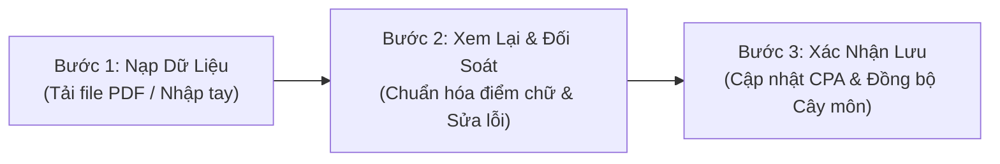

# HƯỚNG DẪN VẬN HÀNH & SỬ DỤNG PHÂN HỆ HỌC VỤ (USER GUIDE)
## Cổng Thông Tin & Cố Vấn Học Vụ Sinh Viên — HaUI Academic Advisor

- **Dự án:** HaUI Academic Advisor (`QUAN-LY-HOC-TAP-TTCSN`)
- **Tài liệu:** Hướng dẫn vận hành người dùng cuối & Cố vấn học tập (Milestone Task 5.2a)
- **Đơn vị thực hiện:** Nhóm 6 — Đề tài Nghiên cứu & Phát triển Hệ thống Cố vấn Học tập Thông minh
- **Đối tượng áp dụng:** Sinh viên Đại học chính quy & Giảng viên Cố vấn học tập Trường Đại học Công nghiệp Hà Nội
- **Thư mục tài liệu:** `tv2-web/docs/report/task-5.2a-user-guide.md`

---

## 1. GIỚI THIỆU TỔNG QUAN HỆ THỐNG

**HaUI Academic Advisor** là nền tảng số hóa học vụ hiện đại được xây dựng nhằm hỗ trợ sinh viên Trường Đại học Công nghiệp Hà Nội (HaUI) chủ động theo dõi tiến độ đào tạo, rà soát điều kiện tốt nghiệp, truy vết mối quan hệ ràng buộc giữa các môn học và lập kế hoạch học tập cá nhân hóa.

Hệ thống được thiết kế theo phong cách giao diện tối giản (*Clinical Blueprint on Frosted Paper*), chú trọng tính rõ ràng, chuẩn xác và trực quan trong từng thao tác.

---

## 2. HƯỚNG DẪN ĐĂNG NHẬP & CHỌN HỒ SƠ SINH VIÊN

### 2.1. Đăng nhập hệ thống (`/login`)
1. Truy cập liên kết ứng dụng trên trình duyệt web (khuyến nghị Google Chrome hoặc Microsoft Edge).
2. Tại màn hình **Đăng nhập**:
   - Nhập **Mã sinh viên** (hoặc địa chỉ Email sinh viên HaUI: `@sv.haui.edu.vn`).
   - Nhập **Mật khẩu** tài khoản.
   - Nhấn nút **Đăng nhập &rarr;** để vào bảng điều khiển Tổng quan.

### 2.2. Sử dụng Tài khoản Mẫu để trải nghiệm (Personas)
Trong môi trường thử nghiệm và trình diễn, hệ thống hỗ trợ tính năng **Điền tài khoản mẫu** nhanh chóng:
- Bấm vào nút `[ ⚡ Điền tài khoản mẫu ]` bên dưới form đăng nhập để nạp sẵn dữ liệu tài khoản:
  - **Hồ sơ 1 — Sinh viên có nguy cơ học vụ (`at-risk`):** Sinh viên Trần Thị Bình (`std-2026-001`) — CPA 1.85, cảnh báo học vụ mức 1, đang nợ môn tiên quyết Toán rời rạc. Phù hợp để trải nghiệm tính năng cảnh báo môn nợ và lập kế hoạch gỡ nợ bù đắp.
  - **Hồ sơ 2 — Sinh viên tiến độ chuẩn (`normal`):** Sinh viên Nguyễn Văn An (`2024604757`) — CPA 3.05, hoàn thành 102/135 tín chỉ, không nợ môn. Phù hợp để theo dõi biểu đồ tiến độ chuẩn và chuẩn bị kế hoạch tốt nghiệp.
  - **Hồ sơ 3 — Sinh viên mới nhập học (`empty`):** Sinh viên Lê Hoàng Nam (`std-2026-empty`) — Tân sinh viên K19, chưa có dữ liệu bảng điểm. Phù hợp để trải nghiệm luồng nhập bảng điểm từ đầu.

---

## 3. HƯỚNG DẪN BÓC TÁCH & NHẬP BẢNG ĐIỂM (`/transcript`)

Khi bắt đầu sử dụng hoặc sau mỗi kỳ thi có kết quả mới, sinh viên tiến hành nạp bảng điểm để hệ thống tính toán lại toàn bộ chỉ số học vụ:



### Bước 1: Nạp dữ liệu
- Mở mục **Nhập bảng điểm** từ thanh điều hướng bên trái.
- Chọn 1 trong 2 phương thức:
  - **Cách 1 (Khuyến nghị): Tải tệp bảng điểm e-HaUI:** Kéo và thả file bảng điểm cá nhân (định dạng `.pdf` tải từ cổng `sv.haui.edu.vn`) vào khu vực Dropzone. Hệ thống sẽ tự động bóc tách các dòng môn học.
  - **Cách 2: Nhập thủ công:** Chọn tab *Nhập thủ công*, điền mã môn, số tín chỉ, điểm thi hệ 10 và học kỳ tương ứng.

### Bước 2: Xem lại & Đối soát bảng điểm
- Hệ thống hiển thị bảng danh sách các môn học vừa được bóc tách.
- Điểm hệ 10 sẽ được tự động quy đổi sang điểm chữ theo thang điểm quy chế HaUI:
  - $8.5 \rightarrow 10.0$: Điểm **A** (Đạt)
  - $8.0 \rightarrow 8.4$: Điểm **B+** (Đạt)
  - $7.0 \rightarrow 7.9$: Điểm **B** (Đạt)
  - $6.5 \rightarrow 6.9$: Điểm **C+** (Đạt)
  - $5.5 \rightarrow 6.4$: Điểm **C** (Đạt)
  - $4.0 \rightarrow 5.4$: Điểm **D / D+** (Đạt mức cảnh báo)
  - Dưới $4.0$: Điểm **F** (Không đạt — Môn nợ)
- Sinh viên có thể bấm trực tiếp vào từng ô điểm để chỉnh sửa nếu có sai sót.

### Bước 3: Xác nhận lưu dữ liệu
- Kiểm tra thẻ tổng kết: Xem tổng số tín chỉ tích lũy và điểm CPA dự tính.
- Bấm nút **Xác nhận cập nhật bảng điểm**.
- Hệ thống sẽ lưu trữ và phát thông báo đồng bộ sang toàn bộ phân hệ: Biểu đồ Dashboard, Sơ đồ Cây môn học và Phân hệ Kế hoạch học tập sẽ được cập nhật đồng thời.

---

## 4. HƯỚNG DẪN SỬ DỤNG BẢNG ĐIỀU KHIỂN TỔNG QUAN (`/dashboard`)

Trang **Tổng quan** cung cấp bức tranh toàn cảnh về tình hình học tập cá nhân với bố cục tinh gọn, không gây rối mắt:

### 4.1. Thẻ chỉ số chính (KPI Cards)
- **Điểm trung bình tích lũy (CPA):** Thể hiện điểm tích lũy trên thang 4 kèm xếp loại học lực tương ứng (Xuất sắc, Giỏi, Khá, Trung bình, Yếu).
- **Tín chỉ tích lũy:** Hiển thị số tín chỉ đã vượt qua so với tổng khối lượng của chương trình đào tạo (ví dụ: `102 / 135 TC`).
- **Tiến độ chương trình:** Tỷ lệ phần trăm hoàn thành CTĐT.

### 4.2. Biểu đồ diễn biến học tập (Progression Chart)
- Đường polyline mềm mại biểu diễn đường cong CPA tích lũy qua các học kỳ liên tiếp.
- Các cột nền Canvas biểu thị khối lượng tín chỉ đăng ký học trong từng kỳ.
- Giúp sinh viên và cố vấn học tập nhanh chóng nhận diện xu hướng học lực (tiến bộ, duy trì ổn định hay suy giảm cần can thiệp).

### 4.3. Bảng học phần đang theo học
- Liệt kê danh sách các môn học sinh viên đang đăng ký học trong học kỳ hiện tại (`IN_PROGRESS`).
- Cho biết số tín chỉ, điểm đánh giá quá trình và nút bấm `account_tree` để xem vị trí của môn học đó trên Sơ đồ Cây môn học.

---

## 5. HƯỚNG DẪN KHÁM PHÁ CÂY MÔN HỌC & TRUY VẾT TIÊN QUYẾT (`/curriculum`)

Sơ đồ Cây môn học số hóa toàn bộ lộ trình đào tạo theo từng học kỳ, giúp sinh viên nắm bắt trực quan cấu trúc chương trình:

```
[Môn tiên quyết: MATH1002 (Toán rời rạc)] ----(Ràng buộc)----> [Môn bị chặn: IT6001 (CTDL & Giải thuật)]
```

### 5.1. Ý nghĩa 4 màu sắc trạng thái môn học
- 🟢 **Màu xanh lá (`PASSED`):** Học phần đã hoàn thành đạt yêu cầu (hiển thị điểm chữ A, B, C...).
- 🔵 **Màu xanh dương (`IN_PROGRESS`):** Học phần đang theo học trong học kỳ này.
- ⚪ **Màu xám trung tính (`ELIGIBLE`):** Học phần đã thỏa mãn mọi điều kiện tiên quyết, sinh viên đủ điều kiện để đăng ký trong kỳ tới.
- 🔴 **Màu đỏ / cam (`BLOCKED` / `FAILED`):** Học phần chưa đủ điều kiện mở khóa do sinh viên đang nợ môn tiên quyết, hoặc môn học đang bị điểm F cần học lại gấp.

### 5.2. Tính năng Truy vết Ràng buộc Học phần (Prerequisite Tracer)
- **Cách thực hiện:** Bấm chuột vào bất kỳ thẻ môn học nào trên sơ đồ.
- **Phản hồi của hệ thống:**
  - Hệ thống tự động làm mờ các môn học không liên quan.
  - **Tô viền xanh lá** cho tất cả các môn tiên quyết bắt buộc phải học trước môn đang chọn.
  - **Tô viền xanh dương** cho tất cả các môn học sẽ được mở khóa phía sau khi sinh viên hoàn thành môn này.
  - Mở thanh thông tin chi tiết (Drawer) bên phải mô tả mục tiêu môn học, đề cương tóm tắt và danh sách môn tiên quyết còn thiếu (nếu có).

### 5.3. Trải nghiệm Cuộn Dọc Tối ưu & Cố định Tiêu đề Kỳ
- Khi danh sách môn học trong một học kỳ kéo dài, sinh viên cuộn chuột xuống để xem toàn bộ danh mục môn.
- **Tiêu đề cột của từng học kỳ (Kỳ 1, Kỳ 2... Kỳ 8) được cố định ở mép trên (`position: sticky`)**, kèm hiệu ứng làm mờ nền kính mờ (`backdrop-filter`). Nhờ đó, sinh viên luôn biết chính xác học phần đang xem thuộc học kỳ nào mà không cần cuộn ngược lên đầu trang.

### 5.4. Đưa môn học vào Kế hoạch học tập (Study Planner)
- Tại Drawer chi tiết môn học, bấm nút **Thêm vào Kế hoạch học tập**.
- Hệ thống sẽ chuyển tiếp sang phân hệ Kế hoạch học tập và tự động chọn môn học này để đưa vào học kỳ dự kiến tiếp theo.

---

## 6. HƯỚNG DẪN KIỂM TOÁN TỐT NGHIỆP & XUẤT BÁO CÁO IN ẤN (`/audit`)

Phân hệ Kiểm toán tốt nghiệp giúp sinh viên chuẩn bị chu đáo hồ sơ trước khi bước vào kỳ xét tốt nghiệp chính thức:

### 6.1. Bảng đối soát 7 Chuẩn đầu ra HaUI
Hệ thống tự động kiểm tra sinh viên đối với 7 tiêu chuẩn xét tốt nghiệp của Trường:
1. **Tổng tín chỉ tích lũy toàn khóa:** Đối chiếu số tín chỉ đã đạt so với chuẩn quy định.
2. **Khối kiến thức đại cương & bắt buộc:** Kiểm tra danh mục môn bắt buộc theo ngành.
3. **Khối kiến thức tự chọn chuyên ngành:** Đảm bảo tích lũy đủ số tín chỉ tự chọn theo tổ hợp.
4. **Chuẩn đầu ra Ngoại ngữ:** Tình trạng nộp chứng chỉ tiếng Anh (TOEIC/VSTEP).
5. **Chuẩn đầu ra Tin học quốc tế:** Tình trạng chứng chỉ MOS hoặc IC3 kèm cảnh báo thời hạn nộp.
6. **Chứng chỉ Giáo dục thể chất & GDQP-AN:** Đã hoàn thành và đủ điều kiện cấp chứng chỉ.
7. **Điểm rèn luyện:** Điểm tích lũy rèn luyện toàn khóa đạt chuẩn quy chế.

### 6.2. Phân định Chế độ Thực tế vs Chế độ Dự kiến
- **Tab Thực tế (Hiện tại):** Phản ánh chính xác kết quả học vụ tính đến thời điểm hiện tại. Nếu còn nợ môn hoặc thiếu chứng chỉ, hệ thống sẽ hiển thị trạng thái `CHƯA ĐỦ ĐIỀU KIỆN TỐT NGHIỆP`.
- **Tab Dự kiến (Kèm Lộ trình Bù đắp):** Giả lập kết quả sau khi sinh viên hoàn thành phương án học tập đã lập trong Study Planner. Giúp sinh viên hình dung được thời điểm tốt nghiệp dự kiến nếu hoàn thành đúng lộ trình.

### 6.3. Lập kế hoạch bù đắp điều kiện còn thiếu
- Nếu kết quả kiểm toán báo chưa đủ điều kiện, nhấn nút `[ 🛠️ Lập kế hoạch bù đắp các điều kiện còn thiếu ]`.
- Hệ thống sẽ tổng hợp toàn bộ các môn nợ, tín chỉ thiếu và đề xuất phương án học kỳ bù đắp chuyển tiếp trực tiếp sang **Study Planner**.

### 6.4. Xuất Báo cáo In ấn Chuẩn A4 (`@media print`)
- Bấm nút **Xuất Báo Cáo In / Lưu PDF** (hoặc sử dụng tổ hợp phím tắt `Ctrl + P`).
- Trình duyệt sẽ mở hộp thoại in với định dạng báo cáo học vụ trang nhã:
  - Tự động ẩn sidebar điều hướng và các nút thao tác thừa.
  - Phân định rõ ràng tiêu đề bản in: *DỮ LIỆU THỰC TẾ (HIỆN TẠI)* hoặc *DỰ KIẾN (KÈM LỘ TRÌNH BÙ ĐẮP)*.
  - Ghi nhận đầy đủ thông tin sinh viên, thời điểm xuất báo cáo và khuyến cáo pháp lý.
  - Sinh viên có thể chọn máy in hoặc lưu thành file PDF để nộp cho Cố vấn học tập hoặc lưu trữ cá nhân.

---

## 7. CÂU HỎI THƯỜNG GẶP (FAQ) & KHUYẾN CÁO PHÁP LÝ

### Câu hỏi 1: Kết quả Kiểm toán trên ứng dụng có thay thế Quyết định tốt nghiệp của Nhà trường không?
> **Khuyến cáo quan trọng:** Không. Ứng dụng HaUI Academic Advisor thực hiện tính toán và đánh giá tự động dựa trên quy chế đào tạo tín chỉ và bảng điểm hiện có nhằm mục đích cố vấn, định hướng lộ trình. Kết quả này **hoàn toàn không thay thế Quyết định công nhận tốt nghiệp chính thức do Hiệu trưởng Trường Đại học Công nghiệp Hà Nội ban hành**.

### Câu hỏi 2: Tại sao điểm CPA trên hệ thống khác với điểm trên cổng e-HaUI?
> Điểm CPA trên hệ thống được đồng bộ từ bảng điểm cá nhân do bạn nạp lên. Nếu có sai lệch, vui lòng tải bảng điểm mới nhất từ `sv.haui.edu.vn` và thực hiện lại thao tác tại mục **Nhập bảng điểm** để hệ thống tính toán lại chính xác.

### Câu hỏi 3: Nếu hệ thống báo thông báo "Công cụ học vụ chưa sẵn sàng (503)", tôi phải làm gì?
> Thông báo này xuất hiện khi máy chủ học vụ đang trong quá trình bảo trì hoặc nâng cấp thuật toán kiểm toán. Để bảo vệ tính toàn vẹn của dữ liệu học vụ, hệ thống kiên quyết không tự tạo số giả. Bạn vui lòng thử lại sau vài phút hoặc liên hệ với bộ phận kỹ thuật để được hỗ trợ.

---

*Tài liệu được phát hành phục vụ nghiệm thu Đề cương Thực tập cơ sở ngành — Nhóm 6.*
